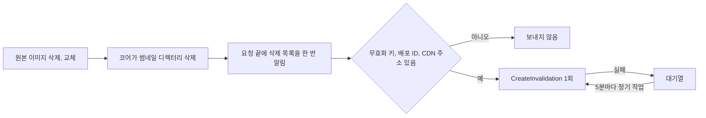
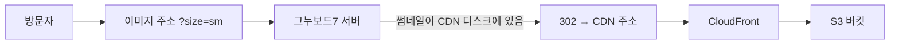

# 그누보드7 CloudFront CDN 플러그인

**그누보드7 플러그인 · sirsoft-cdn_cloudfront**
공개 이미지 썸네일을 Amazon S3 에 저장하고 CloudFront 주소로 내보내며, 썸네일이 지워지면 CDN 캐시를 자동으로 무효화합니다.

<!-- @generated:badges START — ext:docgen 이 갱신. 이 블록 안은 직접 수정하지 않는다 -->
<p align="center">
  
  
  
  
</p>
<!-- @generated:badges END -->

---

[소개](#소개) · [주요 기능](#주요-기능) · [동작 방식](#동작-방식) · [요구 사항](#요구-사항) · [설치](#설치) · [관리자 설정](#관리자-설정) · [사용 방법](#사용-방법) · [다른 확장과의 연동](#다른-확장과의-연동) · [문서](#문서) · [트러블슈팅](#트러블슈팅) · [변경 이력](#변경-이력) · [라이선스](#라이선스)

---

## 소개

<!-- @intent START -->
Amazon S3 에 둔 공개 이미지 썸네일을 CloudFront CDN 주소로 내보내고, 썸네일이 지워질 때 CDN 캐시를 자동으로 무효화합니다.

- 그누보드7 코어의 이미지 썸네일 기능과 짝을 이룹니다. 이 플러그인을 켜면 환경설정 > 업로드 탭 「공개 이미지 썸네일」 줄의 「저장 디스크」와 드라이버 탭의 「공개 자산 스토리지」에 **CloudFront (S3 + CDN)** 선택지가 생깁니다.
- 파일은 환경설정 > 드라이버 탭의 S3 설정(버킷, 지역, 자격 증명)이 가리키는 곳에 그대로 저장되고, 화면에는 CDN 주소로 나갑니다. S3 버킷을 CloudFront 배포의 원본으로 둔 구성에서 씁니다.
- 원본이 지워지거나 바뀌면 코어가 그 원본의 썸네일을 모두 지우고 알려 주며, 이 플러그인이 그 원본의 썸네일 디렉터리를 와일드카드로 묶어 CloudFront 무효화를 한 번에 보냅니다.

의도적으로 하지 않는 것:

- 권한이 걸린 이미지(비밀글 첨부, 숨긴 리뷰 등)의 썸네일은 CDN 에 두지 않습니다. 코어가 그런 이미지의 썸네일 디스크로 CDN 디스크를 고를 수 없게 막습니다.
- 서명 URL, 이미지 변환 서비스(요청 시 크기 변환) 위임은 제공하지 않습니다. 변환 서비스를 쓰려면 아래 「다른 확장과의 연동」의 코어 필터를 쓰는 별도 확장을 만듭니다.
- S3 자격 증명을 무효화에 대신 쓰지 않습니다. 무효화 키는 항상 따로 입력받습니다.
<!-- @intent END -->

## 주요 기능

<!-- @intent START -->
| 영역 | 설명 |
|---|---|
| CDN 디스크 | 코어 S3 디스크 설정을 그대로 쓰고 공개 URL 만 CDN 주소로 바꾼 디스크 `cloudfront` 를 공개 자산 디스크 목록에 올립니다 |
| 캐시 무효화 | 썸네일이 지워지면 원본 하나당 `/{썸네일 디렉터리}/*` 와일드카드와 원본 경로를 모아 요청 하나에 무효화 한 번을 보냅니다. CloudFront 한도를 넘으면 최상위 폴더 안에서 접고, 그래도 넘으면 나눠 보냅니다. 배포 전체를 무효화하지는 않습니다 |
| 실패 재시도 | 무효화가 실패하면 대기열에 넣고 5분, 10분, 20분, 40분 간격으로 다시 보내며 5번 실패하면 멈춥니다. 다시 보낼 때는 시각이 된 대기 건을 모아 요청 하나로 보내고, 진행 중 한도나 호출 제한 오류는 횟수로 세지 않습니다 |
| 설정 화면 | 배포 주소와 무효화 키 저장, 저장된 값으로 하는 연결 시험, 무효화 대기 건수와 마지막 오류 확인 |
<!-- @intent END -->

## 동작 방식

<!-- @intent START -->



<!-- @intent END -->

## 요구 사항

<!-- @generated:requirements START — ext:docgen 이 갱신. 이 블록 안은 직접 수정하지 않는다 -->
| 항목 | 값 |
|---|---|
| 그누보드7 코어 | `>=7.2.1` |
| PHP | `^8.2` |
<!-- @generated:requirements END -->

## 설치

<!-- @generated:install START — ext:docgen 이 갱신. 이 블록 안은 직접 수정하지 않는다 -->
```bash
# 번들 설치 (코어에 동봉된 소스에서 설치)
php artisan plugin:install sirsoft-cdn_cloudfront

# 활성화
php artisan plugin:activate sirsoft-cdn_cloudfront

# 업데이트 (번들 소스 기준 강제 반영)
php artisan plugin:update sirsoft-cdn_cloudfront --force
```

저장소: https://github.com/gnuboard/g7-plugin-sirsoft-cdn_cloudfront
<!-- @generated:install END -->

## 관리자 설정

<!-- @generated:settings-summary START — ext:docgen 이 갱신. 이 블록 안은 직접 수정하지 않는다 -->
| 키 | 의미 | 기본값 |
|---|---|---|
| `cdn_base_url` | CDN 주소 | - |
| `distribution_id` | 배포 ID | - |
| `access_key` | 무효화용 액세스 키 | - |
| `secret_key` | 무효화용 비밀 키 | - |
| `purge_enabled` | 캐시 자동 무효화 | `true` |

개발자용 상세(타입·검증·저장 위치)는 [설정 스키마](docs/settings.md#설정-스키마) 를 보세요.
<!-- @generated:settings-summary END -->

<!-- @intent START -->
- **CDN 주소**: 배포 도메인(또는 배포에 연결한 대체 도메인)입니다. 비워 두면 파일은 S3 에 저장되지만 화면에는 서버를 거친 주소로 나갑니다. 도메인을 바꾸면 이미 만든 썸네일도 새 주소로 나갑니다.
- **배포 ID, 무효화용 키**: 무효화를 보낼 때만 씁니다. 셋 가운데 하나라도 비면 무효화를 보내지 않으며, 대기 중인 재시도도 시도 횟수를 쓰지 않고 기다립니다. 키는 `cloudfront:CreateInvalidation` 과 `cloudfront:GetDistribution` 권한만 준 IAM 사용자로 만드는 것을 권합니다.
- **캐시 자동 무효화**: 끄면 썸네일이 지워져도 무효화를 보내지 않고, 재시도 정기 작업도 실행되지 않습니다. CDN 캐시 만료를 짧게 둔 배포에서 무효화 요금을 아끼려면 끕니다.
<!-- @intent END -->

## 사용 방법

<!-- @intent START -->
**공개 썸네일을 CDN 으로 내보내기**

1. 환경설정 > 드라이버 탭에서 S3 버킷, 지역, 자격 증명을 저장합니다. 이 버킷을 원본으로 하는 CloudFront 배포를 미리 만들어 둡니다.
2. 플러그인을 설치하고 활성화한 뒤 플러그인 설정에서 CDN 주소를 저장합니다.
3. 환경설정 > 업로드 탭 「저장 위치 · 캐시」의 「공개 이미지 썸네일」 줄에서 저장 디스크를 **CloudFront (S3 + CDN)** 로 고르고 저장합니다.
4. 상품 목록 같은 공개 이미지 화면을 열면 썸네일 주소가 CDN 주소로 이동(302)합니다.

**캐시 무효화 켜기**

1. 플러그인 설정에 배포 ID, 무효화용 액세스 키, 비밀 키를 넣고 저장합니다.
2. 「연결 시험」을 눌러 배포 상태와 도메인을 확인합니다. CDN 주소가 그 배포의 도메인이 아니면 경고가 나옵니다.
3. 이미지를 지우거나 바꾼 뒤 「무효화 대기 현황」에서 마지막 성공 시각이 바뀌었는지 확인합니다.

**이미지 변환 서비스에 맡기기 (개발자)**

요청 때마다 크기를 바꿔 주는 이미지 변환 서비스(CDN 의 이미지 최적화 기능 등)를 쓰려면, 코어 필터 훅 `core.thumbnail.filter_url` 을 구독하는 확장을 만들어 봇 화면과 `og:image` 의 썸네일 주소를 그 서비스 주소로 바꿉니다. 사람 화면 주소는 바뀌지 않습니다. 필터는 바꿀 주소(값)와 원래 주소, 규격 정보를 받습니다. 이 플러그인은 그 방식을 구현하지 않습니다 — 파생본을 서버가 만들어 S3 에 두고 CDN 은 저장된 파일만 내보냅니다.
<!-- @intent END -->

## 다른 확장과의 연동

<!-- @generated:integrations START — ext:docgen 이 갱신. 이 블록 안은 직접 수정하지 않는다 -->
**이 확장이 의존하는 확장**

없음 — 코어만으로 동작합니다.

**이 확장에 의존하는 확장** (이 확장을 비활성화하면 함께 영향을 받습니다)

없음.
<!-- @generated:integrations END -->

## 문서

<!-- @generated:docs-index START — ext:docgen 이 갱신. 이 블록 안은 직접 수정하지 않는다 -->
| 문서 | 내용 | 상태 |
|---|---|---|
| [docs/README.md](docs/README.md) | 문서 통합 목차와 실측 집계 | ✅ |
| [docs/architecture.md](docs/architecture.md) | 설계 의도·계층 지도·디렉토리 맵 | ✅ |
| [docs/extension-points.md](docs/extension-points.md) | 발행/구독 훅·미들웨어·채널·스케줄 | ✅ |
| [docs/data-model.md](docs/data-model.md) | 모델·소유 테이블·마이그레이션·Enum | ✅ |
| [docs/settings.md](docs/settings.md) | 설정 스키마·권한·메뉴·라우트·의존 관계 | ✅ |
| [docs/frontend.md](docs/frontend.md) | 레이아웃·액션 핸들러·전역 진입점·에셋 | ✅ |
| [docs/editor-spec.md](docs/editor-spec.md) | 레이아웃 편집기에 선언한 팔레트·컨트롤·샘플 데이터 | ✅ |
| [docs/api/](docs/api/README.md) | API 레퍼런스 (엔드포인트별 파라미터·응답 필드) | ✅ |
| [CHANGELOG.md](CHANGELOG.md) | 변경 이력 | ✅ |
<!-- @generated:docs-index END -->

## 트러블슈팅

<!-- @intent START -->
| 증상 | 원인 | 조치 |
|---|---|---|
| 업로드 탭에 CloudFront 선택지가 없다 | 플러그인이 꺼져 있거나 드라이버 탭에 S3 버킷이 저장되지 않았다 | 플러그인을 활성화하고 S3 버킷을 저장합니다 |
| 썸네일 주소가 CDN 이 아니라 서버 주소로 나온다 | CDN 주소가 비어 있다 | 플러그인 설정에서 CDN 주소를 저장합니다 |
| CDN 주소를 바꿨는데 큐 작업이 옛 주소를 쓴다 | 상주 큐 워커가 다시 뜨지 않았다 | 저장하면 워커에 재시작 신호가 나갑니다. 워커를 자동으로 다시 띄우는 구성이 없으면 직접 재시작합니다 |
| CDN 주소의 이미지가 403 이다 | 배포가 버킷을 읽을 권한이 없다(원본 접근 제어 미설정) | 배포의 원본 접근 설정과 버킷 정책을 확인합니다 |
| 이미지를 바꿨는데 CDN 에 옛 썸네일이 보인다 | 무효화 키가 비었거나 무효화가 실패해 대기 중이다 | 설정 화면의 무효화 대기 현황에서 마지막 오류를 확인합니다 |
| 마지막 오류가 `TooManyInvalidationsInProgress` 다 | 진행 중인 와일드카드 무효화가 CloudFront 한도(배포 전체 15개)에 닿았다 | 기다리면 정기 작업이 다시 보냅니다. 이 오류는 재시도 횟수로 세지 않습니다 |
| 마지막 오류가 `AccessDenied` 다 | 무효화 키에 CloudFront 권한이 없다 | IAM 권한을 고친 뒤 키를 다시 저장합니다 |
| 플러그인을 끄자 썸네일이 서버에서 나온다 | 끄면 CDN 디스크가 사라지고 코어가 기본 썸네일 디스크로 바꿔 쓴다 | 의도된 동작입니다. 다시 켜면 저장한 선택이 되살아납니다 |
<!-- @intent END -->

## 변경 이력

[CHANGELOG.md](CHANGELOG.md)

## 라이선스

MIT
