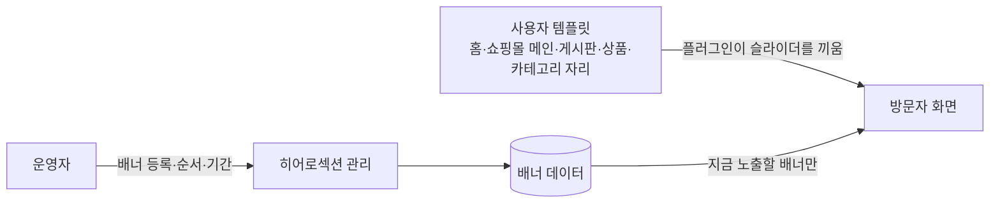

# 그누보드7 히어로섹션 플러그인

**그누보드7 플러그인 · sirsoft-hero_section**
사이트 홈·쇼핑몰 메인과 게시판·상품·카테고리 화면 상단의 히어로섹션(메인 배너)을 관리하고 사용자 템플릿 확장점에 슬라이더로 보여 줍니다. 다른 확장이 노출 위치를 더할 수 있습니다.

<!-- @generated:badges START — ext:docgen 이 갱신. 이 블록 안은 직접 수정하지 않는다 -->
<p align="center">
  
  
  
  
</p>
<!-- @generated:badges END -->

---

[소개](#소개) · [주요 기능](#주요-기능) · [동작 방식](#동작-방식) · [요구 사항](#요구-사항) · [설치](#설치) · [관리자 설정](#관리자-설정) · [사용 방법](#사용-방법) · [다른 확장과의 연동](#다른-확장과의-연동) · [문서](#문서) · [트러블슈팅](#트러블슈팅) · [변경 이력](#변경-이력) · [라이선스](#라이선스)

---

## 소개

<!-- @intent START -->
사이트 첫 화면의 히어로섹션(메인 배너)은 신상품·프로모션·공지·캠페인을 알리는 가장 중요한 자리입니다. 이 플러그인을 쓰면 마케팅·운영 담당자가 개발자 없이 배너를 바꾸고, 정해 둔 기간에 맞춰 자동으로 보이거나 사라지게 할 수 있습니다.

- 기본 사용자 템플릿(sirsoft-basic)의 **사이트 홈**과 **쇼핑몰 메인** 상단에 슬라이더로 나옵니다. 게시판 모듈이 켜져 있으면 **게시판 목록**(게시판마다 다른 배너), 이커머스 모듈이 켜져 있으면 **상품 상세**(상품마다)·**카테고리 목록**(카테고리마다) 상단에도 둘 수 있습니다. 다른 사용자 템플릿도 같은 이름의 자리만 두면 그대로 씁니다.
- 다른 모듈·플러그인이 배너 위치를 더할 수 있습니다(위치 등록 필터).
- 언어별 문구와 PC·모바일 이미지를 따로 넣을 수 있습니다.
- 노출수·클릭수 통계는 이번 판에 없습니다.
<!-- @intent END -->

## 주요 기능

<!-- @intent START -->
| 영역 | 설명 |
|---|---|
| 배너 목록 | 위치(사이트 홈·쇼핑몰 메인·게시판 목록·상품 상세·카테고리 목록, 다른 확장이 더한 위치)별 목록 — 게시판·상품·카테고리(와 다른 확장이 더한 동적) 위치는 배너가 있는 대상 목록(전체·지금 노출 건수)에서 「관리」로 들어가 그 대상의 배너만 다룸(배너 없는 대상은 이름으로 찾아 고름, 「대상 목록으로」는 보던 쪽으로 복귀, 목록을 받지 못하면 다시 받기), 지금 노출 중인 배너 미리보기와 「사이트에서 보기」, 행마다 제작 상태(제목이 빈 언어·모바일 이미지 없음·버튼 주소 없음), 상태(노출중·예약·종료·비활성) 필터, 일괄 노출·비노출·삭제, [순서 변경] 창 |
| 배너 등록·수정 | 언어별 제목·설명·버튼 문구·대체 텍스트, 문구 표시 여부·색상·정렬, PC·모바일 이미지(모바일 없으면 PC 사용), 링크·새 창, 상시 또는 기간 지정 노출, 사용 여부 |
| 편집 확인 | 업로드 중 저장 잠금과 저장이 안 되는 이유 표시, 실제 PC·모바일 크기와 콘텐츠 언어 미리보기·확대(휴대폰에서는 입력 위), 버튼 문구만 있고 주소가 없을 때 경고, 사이트 시간대 예약 안내, 다른 관리자의 수정 충돌 알림 |
| 이미지 구성 | PC 1920×640·모바일 750×1000 표시 비율, 기기별 초점 조절, 선택적 문구 배경 |
| 문구 위치·효과 | 머리글(제목 위 한 줄)·제목·설명·버튼 4줄. 문구 자리는 PC·휴대폰 따로(9칸 빠른 선택·가로/세로 %·편집 미리보기에서 끌기), 문구 상자 폭, 등장 효과 8종(없음·떠오르기·서서히·왼쪽에서·오른쪽에서·확대·흐림 걷힘·글자 하나씩)과 속도·시작 지연 — 줄마다 0.2초씩 늦게 나타남. 움직임 줄이기를 켠 방문자에게는 효과 없음 |
| 영상 배너 | 배너마다 이미지·영상 파일(PC·모바일 MP4·WEBM) 중 선택. 소리 없이 자동 재생하고 끝나면 다음 배너로(한 장이면 반복). PC 이미지는 대표 이미지로 필수. 유튜브 등 제3자 영상 플랫폼은 아직 지원하지 않음 |
| 로딩 표시 | 사이트 화면을 열면 배너를 받는 동안 같은 크기의 스켈레톤이 자리를 잡아 본문이 밀리지 않음 |
| 슬라이더 설정 | 위치마다(게시판·상품·카테고리 위치는 그 위치의 기본값) 자동 재생·전환 간격(3·5·7초)·전환 효과(슬라이드·페이드·큐브·뒤집기·커버플로·겹쳐 넘기기·없음)·표시 폭(본문 폭·화면 전체 — 화면 전체는 이미지만 화면 끝까지, 제목·버튼은 본문 줄에 맞춤)·메뉴 겹치기(화면 전체 폭에서 사이트 상단 메뉴를 배너 위에 투명하게 겹치고, 배너마다 정한 바탕 밝기로 메뉴 글자색을 바꿈 — 이 신호를 지원하는 사이트 템플릿에서만, 기본 템플릿 sirsoft-basic 지원)·최대 높이(PC·태블릿과 휴대폰 따로 px — 비율대로 커지다가 그 높이에서 멈추고 넘치는 이미지는 초점 기준으로 위아래를 자름, 비우면 비율대로. 메뉴 겹치기와 함께 320px 보다 낮게 잡으면 문구 자리가 좁아질 수 있다고 안내) |
| 대상별 슬라이더 설정 | 게시판·상품·카테고리(와 다른 확장이 더한 동적) 위치는 대상을 고르면 「이 대상 설정」에서 자동 재생·간격·전환 효과·표시 폭·메뉴 겹치기·페이징·최대 높이를 항목마다 그 대상만 따로 정함 — 켜지 않은 항목은 위치 기본값을 따르고(위치 기본값을 바꾸면 함께 바뀜), 「자동 재생 끔」·「최대 높이 제한 없음」도 그 대상의 값으로 둘 수 있음. 항목별·전체를 위치 기본값으로 되돌리기, 다른 대상·위치 기본값은 그대로, 지운 대상의 남은 설정도 되돌리기 가능 |
| 배너 구성 | 배너마다 배경형(사진·영상이 띠 전체, 기존 배너 기본)과 프로모션형(바탕색 위에 문구 칸과 그림 칸 — PC 는 문구 왼쪽·그림 오른쪽 또는 반대, 휴대폰은 위아래) 중 선택, 바탕색, PC·휴대폰 문구 폭(비우면 공통 폭), 여러 줄 제목·설명, 차례로 나타나는 등장 효과(머리글→제목→설명)와 그림 등장 효과(서서히·오른쪽에서), 프로모션형 추천값 단추(작업본에만 적용), 편집 화면에 이 배너에 적용될 슬라이더 설정 요약 |
| 사용자 화면 | 기기에 맞는 이미지 자동 전환, 휴대폰에서 손가락으로 넘기기, 마지막 배너 다음에 첫 배너가 이어지는 무한 반복, 현재 언어 문구(없으면 기본 언어), 노출할 배너가 없으면 자리째 숨김 |
| 운영 | 조회 / 등록·수정 / 삭제 권한 분리, 모든 작업 활동 로그 기록, 이미지·영상 최대 용량·사용자 화면 캐시 시간 설정 |

<!-- @intent END -->

## 동작 방식

<!-- @intent START -->


노출 상태는 정해 둔 기간과 사용 여부로 그때그때 판단합니다 — 시작 시각이 되면 보이고 종료 시각이 지나면 사라집니다.
<!-- @intent END -->

## 요구 사항

<!-- @generated:requirements START — ext:docgen 이 갱신. 이 블록 안은 직접 수정하지 않는다 -->
| 항목 | 값 |
|---|---|
| 그누보드7 코어 | `>=7.2.0` |
| PHP | `^8.2` |
<!-- @generated:requirements END -->

## 설치

<!-- @generated:install START — ext:docgen 이 갱신. 이 블록 안은 직접 수정하지 않는다 -->
```bash
# 번들 설치 (코어에 동봉된 소스에서 설치)
php artisan plugin:install sirsoft-hero_section

# 활성화
php artisan plugin:activate sirsoft-hero_section

# 업데이트 (번들 소스 기준 강제 반영)
php artisan plugin:update sirsoft-hero_section --force
```
<!-- @generated:install END -->

## 관리자 설정

<!-- @generated:settings-summary START — ext:docgen 이 갱신. 이 블록 안은 직접 수정하지 않는다 -->
| 키 | 의미 | 기본값 |
|---|---|---|
| `max_upload_mb` | 이미지 최대 용량(MB) | `5` |
| `max_video_upload_mb` | 영상 최대 용량(MB) | `30` |
| `public_cache_minutes` | 사용자 화면 배너 캐시 시간(분) | `10` |
| `public_asset_disk` | 공개 자산 디스크 | - |

개발자용 상세(타입·검증·저장 위치)는 [설정 스키마](docs/settings.md#설정-스키마) 를 보세요.
<!-- @generated:settings-summary END -->

<!-- @intent START -->
- **이미지 최대 용량**: 고화질 배너를 올려야 할 때 올립니다(최대 10MB). 서버 PHP 한도보다 크게 잡아도 그 한도를 넘는 파일은 올라가지 않으니 트러블슈팅 표를 함께 보세요.
- **영상 최대 용량**: 영상 파일 배너를 쓸 때 정합니다(기본 30MB, 최대 100MB). 이미지처럼 서버 PHP 한도를 넘는 파일은 올라가지 않으니, 영상을 쓰려면 PHP 업로드 한도를 이 값 이상으로 올려 두세요.
- **사용자 화면 배너 캐시 시간**: 방문자가 많으면 늘리고, 0 으로 두면 매번 새로 읽습니다. 배너를 저장·삭제·순서 변경하면 캐시와 관계없이 바로 반영됩니다.
<!-- @intent END -->

## 사용 방법

<!-- @intent START -->
관리자 화면이 추가되면 쓰는 대표 흐름:

1. 관리자 메뉴 「히어로섹션 관리」 → 위치(사이트 홈) → [배너 등록] → PC 이미지·문구·링크 입력 → 저장 → 사이트 홈 상단에 나타남(목록의 「사이트에서 보기」로 확인).
2. 기간 지정으로 저장하면 「예약」으로 보이다가 시작 시각에 자동 노출, 종료 시각에 자동으로 사라짐.
3. [순서 변경] 창에서 끌거나 ↑↓ 로 바꾸고 저장하면 사용자 화면 순서도 바로 바뀜.
4. 게시판마다 다른 배너: 위치 「게시판 목록」 → 게시판 고르기 칸에서 이름으로 찾아 고름 → [배너 등록] → 저장 → 그 게시판 목록 화면 상단에만 나타남(「사이트에서 보기」가 그 게시판 화면을 연다). 상품 상세·카테고리 목록도 같다. 배너가 없는 게시판에는 아무것도 나오지 않는다.
<!-- @intent END -->

## 다른 확장과의 연동

<!-- @generated:integrations START — ext:docgen 이 갱신. 이 블록 안은 직접 수정하지 않는다 -->
**이 확장이 의존하는 확장**

없음 — 코어만으로 동작합니다.

**이 확장에 의존하는 확장** (이 확장을 비활성화하면 함께 영향을 받습니다)

없음.

**함께 쓰면 연동되는 확장** (manifest `integrations` — 없어도 이 확장은 동작합니다)

| 확장 | 유형 | 버전 제약 | 번들 |
|---|---|---|---|
| `sirsoft-board` | 모듈 | `*` | ✅ |
| `sirsoft-ecommerce` | 모듈 | `*` | ✅ |
<!-- @generated:integrations END -->

다른 모듈·플러그인은 위치 등록 필터로 노출 위치를 더할 수 있습니다. 위치를 등록하고, 배너가 보일 화면(템플릿 또는 자기 화면 레이아웃)에 위치 키와 같은 이름의 확장점을 두면 히어로가 그 자리에 슬라이더를 붙입니다. 히어로 코드를 고치거나 출력 조각을 복사하지 않아도 되고, 추가한 위치는 관리자에서 사이트 홈·쇼핑몰 메인처럼 따로 관리합니다. 순서와 예제는 [docs/extension-points.md](docs/extension-points.md) 「다른 확장이 위치를 더할 때 — 사이트 화면까지」에 있습니다.

<!-- @intent START -->
게시판·이커머스 모듈은 선택 연동입니다 — 켜져 있으면 히어로가 게시판 목록·상품 상세·카테고리 목록 위치를 스스로 더하고, 꺼지면 그 위치가 빠집니다(배너는 지우지 않고 「등록되지 않은 위치」로 남겨 두며, 다시 켜면 그대로 보입니다). 다른 모듈·플러그인은 필터 `sirsoft-hero_section.position.registered_positions` 로 위치를 더할 수 있습니다 — 계약과 예시는 [docs/extension-points.md](docs/extension-points.md).
<!-- @intent END -->

### 테마 제작자 안내

배너는 사용 중인 사용자 템플릿(테마)이 열어 둔 자리에만 나옵니다. 기본 템플릿(sirsoft-basic)은 아래 자리를 모두 갖고 있습니다. 다른 템플릿이나 7.2.0 전 기본 템플릿을 복사해 만든 템플릿은 배너를 띄울 화면 레이아웃 본문 맨 앞에 위치 이름과 같은 빈 확장점을 한 줄씩 넣습니다.

```html
<extension-point name="board_hero"><default/></extension-point>
```

| 위치 이름 | 넣을 화면 | 필요한 확장 |
|---|---|---|
| `home_hero` | 사이트 홈 | — |
| `shop_hero` | 쇼핑몰 메인 | — |
| `board_hero` | 게시판 목록 | 게시판 모듈 |
| `product_hero` | 상품 상세 | 이커머스 모듈 |
| `category_hero` | 카테고리 목록 | 이커머스 모듈 |
| 다른 확장이 더한 위치 | 그 확장이 안내하는 화면 | 그 확장 |

- 자리를 두지 않아도 오류는 없습니다. 사이트 화면은 그대로이고 배너만 나오지 않으며, 관리자 배너 목록의 그 위치에 「지금 쓰는 사이트 템플릿에서 이 배너 자리를 찾지 못했습니다」가 보입니다.
- 게시판·상품·카테고리 배너는 화면 주소의 값으로 대상을 찾습니다(게시판·카테고리는 `slug`, 상품은 `product_code`). 확장점에 넘길 값은 없습니다. 주소의 매개변수 이름이 다른 템플릿은 히어로 조각을 템플릿에서 덮어써 이름을 맞춥니다.
- 「화면 전체 폭」과 「메뉴 겹치기」까지 쓰려면 자리를 본문 상자 밖에 두고 본문 상자 클래스를 확장점 속성으로 넘기는 등 추가 계약이 있습니다. 자리를 본문 안에 두기만 하면 두 설정 모두 자리 폭 그대로 보입니다.
- 자세한 계약과 기본 템플릿의 예는 [docs/extension-points.md](docs/extension-points.md) 「레이아웃 확장」에 있습니다.

## 문서

<!-- @generated:docs-index START — ext:docgen 이 갱신. 이 블록 안은 직접 수정하지 않는다 -->
| 문서 | 내용 | 상태 |
|---|---|---|
| [docs/README.md](docs/README.md) | 문서 통합 목차와 실측 집계 | ✅ |
| [docs/architecture.md](docs/architecture.md) | 설계 의도·계층 지도·디렉토리 맵 | ✅ |
| [docs/extension-points.md](docs/extension-points.md) | 발행/구독 훅·미들웨어·채널·스케줄 | ✅ |
| [docs/data-model.md](docs/data-model.md) | 모델·소유 테이블·마이그레이션·Enum | ✅ |
| [docs/settings.md](docs/settings.md) | 설정 스키마·권한·메뉴·라우트·의존 관계 | ✅ |
| [docs/frontend.md](docs/frontend.md) | 레이아웃·액션 핸들러·전역 진입점·에셋 | ✅ |
| [docs/editor-spec.md](docs/editor-spec.md) | 레이아웃 편집기에 선언한 팔레트·컨트롤·샘플 데이터 | ✅ |
| [docs/api/](docs/api/README.md) | API 레퍼런스 (엔드포인트별 파라미터·응답 필드) | ✅ |
| [CHANGELOG.md](CHANGELOG.md) | 변경 이력 | ✅ |
<!-- @generated:docs-index END -->

## 트러블슈팅

<!-- @intent START -->
| 증상 | 원인 | 조치 |
|---|---|---|
| 배너 이미지 업로드가 용량 오류로 실패하거나, 큰 파일이 비어서 올라감 | 서버 PHP 의 `upload_max_filesize`·`post_max_size` 가 플러그인 설정 「이미지 최대 용량」보다 작음 — 실제 한도는 셋 중 가장 작은 값 | php.ini(또는 PHP-FPM 풀 설정)에서 두 값을 올리고 PHP 를 다시 시작합니다. `post_max_size` 는 `upload_max_filesize` 보다 크게 둡니다 |
| 「메뉴 겹치기」를 켰는데 메뉴가 배너 위로 올라가지 않음 | 그 위치의 표시 폭이 「본문 폭에 맞춤」 — 메뉴 겹치기는 화면 전체 폭에서만 적용됨. 또는 사이트 템플릿이 메뉴 겹침 신호를 지원하지 않음 | 배너 목록 위치 설정에서 표시 폭을 「화면 전체 폭」으로 바꿔 저장합니다. 다른 템플릿이면 템플릿 제작자에게 `data-header-overlay` 지원을 문의합니다 |
| 메뉴 글자가 배너 사진에 묻혀 안 보임 | 배너의 「배너 바탕 밝기」가 사진과 맞지 않음 | 배너 수정 화면 「문구 위치·효과」에서 어두운 사진은 「어두움(메뉴 글자 흰색)」, 밝은 사진은 「밝음(메뉴 글자 검은색)」을 고릅니다 |
| 영상 파일 배너가 영상 대신 대표 이미지로만 보이거나 바로 다음 배너로 넘어감 | 영상 파일을 브라우저가 재생하지 못함(지원하지 않는 코덱 등) — 재생할 수 없는 영상은 이미지 배너처럼 넘어감 | H.264 MP4 또는 VP9 WEBM 으로 다시 내보내 올립니다. 움직임 줄이기를 켠 기기에서는 멈춘 채 시작하니 「배너 다시 재생」 단추를 누릅니다 |
| 게시판(또는 상품·카테고리) 탭이 없거나 「등록되지 않은 위치」로 보임 | 게시판·이커머스 모듈이 꺼져 있음 — 그 모듈이 켜져 있을 때만 위치가 생김. 배너는 지워지지 않고 남아 있음 | 모듈 관리에서 모듈을 켜면 탭과 배너가 그대로 돌아옵니다. 「등록되지 않은 위치」 탭에서 다른 위치로 옮길 수도 있습니다 |
| 게시판 배너 목록에 「찾을 수 없습니다(지워졌을 수 있습니다)」가 보임 | 배너를 붙인 게시판(상품·카테고리)이 지워짐 — 배너는 남지만 사이트에는 보이지 않음 | 배너 수정 화면에서 다른 대상을 고르거나 배너를 지웁니다 |
| 배너를 등록했는데 사이트 홈(또는 쇼핑몰 메인·게시판 목록·상품 상세·카테고리 목록)에 보이지 않음 | ① 사용 중인 사용자 템플릿에 그 위치의 자리(`home_hero`·`shop_hero`·`board_hero`·`product_hero`·`category_hero`)가 없음 ② 배너 상태가 노출중이 아님(예약·종료·비활성) ③ 플러그인이 꺼져 있음 | ① 그 화면 템플릿 본문 맨 앞에 `<extension-point name="home_hero"><default/></extension-point>` 처럼 위치 이름의 빈 자리를 둡니다(기본 템플릿은 이미 있음 — 「테마 제작자 안내」 참고) ② 관리 목록의 상태 열과 노출 기간을 확인합니다 ③ 플러그인 관리에서 켭니다. 저장·순서 변경은 캐시와 관계없이 바로 반영됩니다 |
<!-- @intent END -->

## 변경 이력

[CHANGELOG.md](CHANGELOG.md)

## 라이선스

MIT

이 플러그인의 사용자 슬라이더는 [Swiper](https://swiperjs.com) 14.3.0(MIT, Copyright 2014-2026 Vladimir Kharlampidi)을 빌드 산출물에 함께 담아 씁니다. 저작권 고지는 `dist/js/plugin.iife.js` 안에 남아 있습니다.
