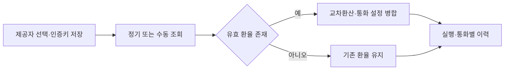

# 그누보드7 수출입은행 환율 플러그인

**그누보드7 플러그인 · sirsoft-koreaexim**
공식 환율 자동 갱신과 갱신 이력·실패 알림을 제공합니다.

<!-- @generated:badges START — ext:docgen 이 갱신. 이 블록 안은 직접 수정하지 않는다 -->
<p align="center">
  
  
  
  
  
</p>
<!-- @generated:badges END -->

---

[소개](#소개) · [주요 기능](#주요-기능) · [동작 방식](#동작-방식) · [요구 사항](#요구-사항) · [설치](#설치) · [관리자 설정](#관리자-설정) · [사용 방법](#사용-방법) · [다른 확장과의 연동](#다른-확장과의-연동) · [문서](#문서) · [트러블슈팅](#트러블슈팅) · [변경 이력](#변경-이력) · [라이선스](#라이선스)

---

## 소개

<!-- @intent START -->
수출입은행의 현재환율을 쇼핑몰의 기본통화 기준으로 환산하여 적용합니다. 운영자가 이커머스 설정에서 제공자를 선택한 경우에만 자동 적용하며, 과거 주문의 금액이나 환율 스냅샷은 수정하지 않습니다.
<!-- @intent END -->

## 주요 기능

<!-- @intent START -->
| 영역 | 제공 기능 |
|---|---|
| 갱신 | 한국시간 정기 실행, 제한된 재시도, 수동 갱신과 연결 테스트 |
| 통화 | 기본통화 교차환산, JPY 100단위와 CNY/CNH 별칭, 미지원·0 환율 보존 |
| 운영 | 통화별 변경 이력, 보존기간 정리, 코어 메일·사이트 알림 |

<!-- @intent END -->

## 동작 방식

<!-- @intent START -->


<!-- @intent END -->

## 요구 사항

<!-- @generated:requirements START — ext:docgen 이 갱신. 이 블록 안은 직접 수정하지 않는다 -->
| 항목 | 값 |
|---|---|
| 그누보드7 코어 | `>=7.1.0` |
| PHP | `^8.2` |
| 의존 모듈 | `sirsoft-ecommerce` `>=1.3.0` |
<!-- @generated:requirements END -->

## 설치

<!-- @generated:install START — ext:docgen 이 갱신. 이 블록 안은 직접 수정하지 않는다 -->
```bash
# 번들 설치 (코어에 동봉된 소스에서 설치)
php artisan plugin:install sirsoft-koreaexim

# 활성화
php artisan plugin:activate sirsoft-koreaexim

# 업데이트 (번들 소스 기준 강제 반영)
php artisan plugin:update sirsoft-koreaexim --force
```

저장소: https://github.com/gnuboard/g7-plugin-sirsoft-koreaexim
<!-- @generated:install END -->

## 관리자 설정

<!-- @generated:settings-summary START — ext:docgen 이 갱신. 이 블록 안은 직접 수정하지 않는다 -->
| 키 | 의미 | 기본값 |
|---|---|---|
| `auth_key` | 인증키 | - |
| `auto_manage` | 환율 자동 관리 사용 | `false` |
| `update_time` | 갱신 시각 (한국시간) | `11:30` |
| `run_days` | 실행 요일 | `[1,2,3,4,5]` |
| `retry_max` | 최대 재시도 | `3` |
| `rate_type` | 환율 종류 | `deal_bas_r` |
| `rate_decimal_places` | 환율 소수 자릿수 | `6` |
| `lookback_days` | 직전 영업일 탐색 일수 | `7` |
| `history_retention_days` | 이력 보존 일수 | `365` |
| `notify_on_failure` | 실패 알림 | `true` |

개발자용 상세(타입·검증·저장 위치)는 [설정 스키마](docs/settings.md#설정-스키마) 를 보세요.
<!-- @generated:settings-summary END -->

<!-- @intent START -->
인증키를 먼저 저장하고 연결 테스트로 수신 여부를 확인합니다. 자동 관리를 켠 뒤 이커머스의 언어/통화 탭에서 제공자를 선택합니다. 갱신 시각은 한국시간이며 11:00 이후를 권장합니다. 재시도는 정기 실행 이후에만, 지정 요일과 최대 횟수 안에서 이루어집니다. 빈 응답이 11시 이후에 오면 비영업일로 보고 그날 재시도를 종료합니다.
<!-- @intent END -->

## 사용 방법

<!-- @intent START -->
1. 플러그인 관리 → 수출입은행 환율 카드의 ⋮ → 설정 → 상태·갱신 설정에서 인증키 저장 → 연결 테스트 → 자동 관리 사용을 켜고 저장합니다. 별도 시스템 메뉴는 등록하지 않습니다.
2. 이커머스 언어/통화 설정에서 수출입은행 환율을 선택한 뒤 지금 갱신을 실행합니다. 관리 통화의 환율 입력만 잠기고 나머지 표시·절사 설정은 편집할 수 있습니다.
3. 갱신 이력 탭에서 상태·날짜로 검색하고 행을 펼쳐 통화별 이전값과 새값을 확인합니다. 메일 또는 사이트 알림 채널을 선택하면 코어 알림 템플릿을 편집할 수 있습니다.
4. 상단 ‘뒤로’ 또는 하단 ‘취소’를 누르면 플러그인 관리 목록으로 돌아갑니다. ‘뒤로’는 갱신 이력 탭에서도 사용할 수 있습니다.

자동 실행에는 서버 스케줄러가 필요합니다. 스케줄러가 없는 환경에서는 ‘지금 갱신’으로 동일하게 실행할 수 있습니다. 여러 서버가 실행하는 구성은 실행 잠금·호출 예산·알림 중복 방지를 위해 공유 캐시 저장소를 사용해야 합니다.

환율 자릿수는 `rate_decimal_places`가 정하고, 상품 가격의 반올림·절사는 통화별 설정이 정합니다. 갱신된 값은 다음 페이지 로드의 통화 설정에 반영되며 기존 주문은 저장 당시 스냅샷을 계속 사용합니다. 공휴일 목록은 별도로 관리하지 않고 한국시간 11시 이후의 빈 고시 응답을 비영업일로 판단합니다.

플러그인을 비활성화하면 환율 입력 잠금이 해제됩니다. 선택한 제공자, 기존 환율·갱신 이력·코어 알림 정의는 보존되며 다시 활성화하면 기존 선택을 사용할 수 있습니다.
<!-- @intent END -->

## 다른 확장과의 연동

<!-- @generated:integrations START — ext:docgen 이 갱신. 이 블록 안은 직접 수정하지 않는다 -->
**이 확장이 의존하는 확장**

| 확장 | 유형 | 버전 제약 | 번들 |
|---|---|---|---|
| `sirsoft-ecommerce` | 모듈 | `>=1.3.0` | ✅ |

**이 확장에 의존하는 확장** (이 확장을 비활성화하면 함께 영향을 받습니다)

없음.
<!-- @generated:integrations END -->

## 문서

<!-- @generated:docs-index START — ext:docgen 이 갱신. 이 블록 안은 직접 수정하지 않는다 -->
| 문서 | 내용 | 상태 |
|---|---|---|
| [docs/README.md](docs/README.md) | 문서 통합 목차와 실측 집계 | ✅ |
| [docs/architecture.md](docs/architecture.md) | 설계 의도·계층 지도·디렉토리 맵 | ✅ |
| [docs/extension-points.md](docs/extension-points.md) | 발행/구독 훅·미들웨어·채널·스케줄 | ✅ |
| [docs/data-model.md](docs/data-model.md) | 모델·소유 테이블·마이그레이션·Enum | ✅ |
| [docs/settings.md](docs/settings.md) | 설정 스키마·권한·메뉴·라우트·의존 관계 | ✅ |
| [docs/frontend.md](docs/frontend.md) | 레이아웃·액션 핸들러·전역 진입점·에셋 | ✅ |
| [docs/editor-spec.md](docs/editor-spec.md) | 레이아웃 편집기에 선언한 팔레트·컨트롤·샘플 데이터 | ✅ |
| [docs/api/](docs/api/README.md) | API 레퍼런스 (엔드포인트별 파라미터·응답 필드) | ✅ |
| [CHANGELOG.md](CHANGELOG.md) | 변경 이력 | ✅ |
<!-- @generated:docs-index END -->

## 트러블슈팅

<!-- @intent START -->
| 증상 | 확인·조치 |
|---|---|
| 인증 오류 | 인증키를 다시 확인하여 저장하고 연결 테스트 실행 |
| 네트워크 오류 | 서버의 외부 통신·프록시 설정 확인. 기존 환율은 유지됨 |
| 데이터 없음 | 11시 이전이면 발표 전일 수 있음. 이후에는 직전 영업일 환율 유지 |
| 관리되지 않는 통화 | 제공자 선택·자동 관리·키 설정과 기본통화 지원 여부 확인 |
| 수동 갱신 제한 | 60초 간격, 하루 20회 제한. 실제 외부 요청은 하루 1,000회 이내 |

<!-- @intent END -->

## 변경 이력

[CHANGELOG.md](CHANGELOG.md)

## 라이선스

MIT
