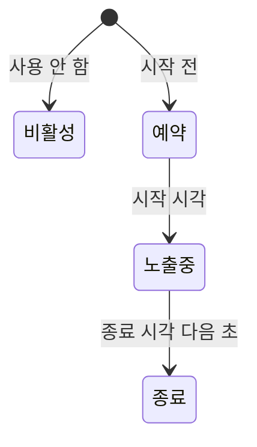
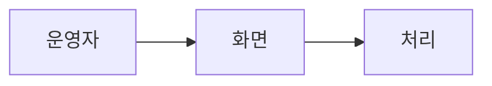

# 그누보드7 팝업 플러그인

**그누보드7 플러그인 · sirsoft-popup**
공지·프로모션·점검 안내처럼 방문자가 꼭 봐야 하는 내용을 사용자 화면 위 팝업 레이어로 띄우고, 여러 건이면 한 레이어 안에서 넘겨 보여 줍니다.

<!-- @generated:badges START — ext:docgen 이 갱신. 이 블록 안은 직접 수정하지 않는다 -->
<p align="center">
  
  
  
  
</p>
<!-- @generated:badges END -->

---

[소개](#소개) · [주요 기능](#주요-기능) · [동작 방식](#동작-방식) · [요구 사항](#요구-사항) · [설치](#설치) · [관리자 설정](#관리자-설정) · [사용 방법](#사용-방법) · [다른 확장과의 연동](#다른-확장과의-연동) · [문서](#문서) · [트러블슈팅](#트러블슈팅) · [변경 이력](#변경-이력) · [라이선스](#라이선스)

---

## 소개

<!-- @intent START -->
휴무·배송 지연·시스템 점검 공지, 기간 한정 프로모션, 이벤트 안내처럼 방문자가 반드시 봐야 하는 내용을 사용자 화면 위 팝업 레이어로 띄웁니다. 조건에 맞는 팝업이 여러 개면 한 레이어 안에서 순서대로 넘겨 보여 줍니다.

사용자 템플릿을 고치지 않고 공통 확장점(`user_global_overlay`)에 붙으므로, 그 확장점을 둔 템플릿이면 어디서나 동작합니다. 페이지 안 고정 배너(히어로섹션)와는 별개입니다. 노출·클릭 통계, 팝업별 위치·크기 지정, 페이지 이름으로 노출 페이지 고르기는 하지 않습니다.
<!-- @intent END -->

## 주요 기능

<!-- @intent START -->
| 영역 | 기능 |
|------|------|
| 등록·수정 | 관리용 제목, 사용 여부, 내용 유형(이미지형 — PC·모바일 이미지·alt·링크·새 창 / 직접 작성형 — 에디터), 언어별 입력(비운 언어는 기본 언어로), 저장 전 PC·모바일 미리보기, 동시 수정 충돌 비교 |
| 노출 조건 | 노출 기간(상시/기간 지정 — 시작·종료에 자동 노출·종료), 노출 페이지(전체/경로 지정 — `/shop` 은 하위 경로 포함, `/` 는 홈만), 노출 대상(전체/비회원만/회원만), 노출 기기(전체/PC/모바일) |
| 목록 | 상태(노출중·예약·종료·비활성)·기기·제목 검색, 지금 노출 중 요약, 일괄 노출·비노출·복사·삭제, [순서 변경] 창(= 캐러셀 순서) |
| 표시 방식(전역) | PC 위치(중앙/좌표)·크기, 모바일(중앙/하단 시트), 배경 어둡게·배경 클릭 닫기, 자동 넘김·간격, 닫기 옵션(오늘 하루/N일간 보지 않기/닫기만) |
| 사용자 화면 | 캐러셀(이전·다음·위치 표시·일시정지, 가로로 미끄러지는 장 전환, 마우스·손가락으로 끌어 넘기기 — 끌다 놓으면 링크로 이동하지 않음), 위쪽 손잡이로 창 옮기기(화살표 키 가능, 헤더·쿠키 배너를 피해 놓임)·모바일 하단 시트는 끌어 내려 닫기, ESC·←→·포커스 가둠·스크린리더, 움직임 줄이기 설정 존중, GDPR 쿠키 배너를 가리지 않음, 검색엔진 봇에는 출력 안 함 |
| 운영 | 권한 3단계(조회/등록·수정/삭제), 활동 로그, 임시 이미지 자동 정리 |

| 영역 | 설명 |
|---|---|
| - | - |
<!-- @intent END -->

## 동작 방식

<!-- @intent START -->
```mermaid
flowchart LR
  A[방문자가 페이지를 연다] --> B[공개 API: 사용 중·기간 안·대상(손님/회원)이 맞는 팝업]
  B --> C{브라우저에서 거름}
  C -->|노출 페이지·기기·보지 않기 기록| D[남은 팝업을 순서대로 한 레이어에]
  D --> E[닫기: 새로고침 전까지 숨김]
  D --> F[보지 않기: 그때 보이던 팝업을 기간 동안 숨김]
```




<!-- @intent END -->

## 요구 사항

<!-- @generated:requirements START — ext:docgen 이 갱신. 이 블록 안은 직접 수정하지 않는다 -->
| 항목 | 값 |
|---|---|
| 그누보드7 코어 | `>=7.2.0` |
| PHP | `^8.2` |
<!-- @generated:requirements END -->

## 설치

<!-- @generated:install START — ext:docgen 이 갱신. 이 블록 안은 직접 수정하지 않는다 -->
```bash
# 번들 설치 (코어에 동봉된 소스에서 설치)
php artisan plugin:install sirsoft-popup

# 활성화
php artisan plugin:activate sirsoft-popup

# 업데이트 (번들 소스 기준 강제 반영)
php artisan plugin:update sirsoft-popup --force
```
<!-- @generated:install END -->

## 관리자 설정

<!-- @generated:settings-summary START — ext:docgen 이 갱신. 이 블록 안은 직접 수정하지 않는다 -->
| 키 | 의미 | 기본값 |
|---|---|---|
| `pc_position` | PC 위치 | `center` |
| `pc_left` | 왼쪽에서(px) | `80` |
| `pc_top` | 위에서(px) | `120` |
| `pc_width` | 너비(px) | `480` |
| `pc_height` | 높이(px) | `520` |
| `mobile_style` | 모바일 표시 | `sheet` |
| `dim_background` | 팝업 뒤 배경 어둡게 | `true` |
| `close_on_backdrop` | 배경을 누르면 닫기 | `false` |
| `autoplay` | 여러 개일 때 자동 넘김 | `true` |
| `autoplay_interval` | 넘김 간격(초) | `6` |
| `dismiss_mode` | 닫기 옵션 | `today` |
| `dismiss_days` | 보지 않을 일수 | `7` |
| `max_upload_mb` | 이미지 최대 용량(MB) | `5` |
| `public_cache_minutes` | 사용자 화면 팝업 캐시 시간(분) | `10` |

개발자용 상세(타입·검증·저장 위치)는 [설정 스키마](docs/settings.md#설정-스키마) 를 보세요.
<!-- @generated:settings-summary END -->

<!-- @intent START -->
- 표시 방식은 모든 팝업에 똑같이 적용됩니다. 너비·높이는 이미지 권장 크기로도 안내되므로, 바꾸면 이미 올린 이미지가 잘리지 않고 여백이 생길 수 있습니다.
- 「N일간 보지 않기」의 일수를 바꿔도 이미 기록된 방문자의 만료는 바뀌지 않습니다.
- 이미지 최대 용량은 서버 PHP 한도(upload_max_filesize·post_max_size)보다 크게 잡아도 그 이상은 올라가지 않습니다(설정 화면에 현재 서버 한도가 보입니다).
<!-- @intent END -->

## 사용 방법

<!-- @intent START -->
1. **점검 공지**: [팝업 등록] → 직접 작성형 → 본문 입력 → 노출 기간 「기간 지정」으로 점검 전날~점검 끝 → 저장. 시작 시각에 저절로 뜨고 끝나면 내려갑니다.
2. **쇼핑몰 프로모션**: 이미지형 → PC·모바일 이미지와 alt, 링크(`/shop/...`) → 노출 페이지 「라우트 지정」 `/shop` → 저장. 쇼핑몰과 그 하위 페이지에서만 뜹니다.
3. **잠시 내리기**: 목록에서 고른 뒤 [비노출]. 삭제는 이미지 파일까지 지워져 되돌릴 수 없습니다.
<!-- @intent END -->

## 다른 확장과의 연동

<!-- @generated:integrations START — ext:docgen 이 갱신. 이 블록 안은 직접 수정하지 않는다 -->
**이 확장이 의존하는 확장**

없음 — 코어만으로 동작합니다.

**이 확장에 의존하는 확장** (이 확장을 비활성화하면 함께 영향을 받습니다)

없음.
<!-- @generated:integrations END -->

## 문서

<!-- @generated:docs-index START — ext:docgen 이 갱신. 이 블록 안은 직접 수정하지 않는다 -->
| 문서 | 내용 | 상태 |
|---|---|---|
| [docs/README.md](docs/README.md) | 문서 통합 목차와 실측 집계 | ✅ |
| [docs/architecture.md](docs/architecture.md) | 설계 의도·계층 지도·디렉토리 맵 | ✅ |
| [docs/extension-points.md](docs/extension-points.md) | 발행/구독 훅·미들웨어·채널·스케줄 | ✅ |
| [docs/data-model.md](docs/data-model.md) | 모델·소유 테이블·마이그레이션·Enum | ✅ |
| [docs/settings.md](docs/settings.md) | 설정 스키마·권한·메뉴·라우트·의존 관계 | ✅ |
| [docs/frontend.md](docs/frontend.md) | 레이아웃·액션 핸들러·전역 진입점·에셋 | ✅ |
| [docs/editor-spec.md](docs/editor-spec.md) | 레이아웃 편집기에 선언한 팔레트·컨트롤·샘플 데이터 | ✅ |
| [docs/api/](docs/api/README.md) | API 레퍼런스 (엔드포인트별 파라미터·응답 필드) | ✅ |
| [CHANGELOG.md](CHANGELOG.md) | 변경 이력 | ✅ |
<!-- @generated:docs-index END -->

## 트러블슈팅

<!-- @intent START -->
| 증상 | 원인 | 조치 |
|------|------|------|
| 팝업을 등록했는데 사용자 화면에 안 뜬다 | 상태가 예약·종료·비활성이거나, 노출 페이지·대상·기기가 맞지 않거나, 그 브라우저에 「보지 않기」 기록이 있다 | 목록 상태 확인 → 조건 확인 → 다른 브라우저(또는 쿠키 `g7_popup_dismissed` 삭제)로 확인 |
| `/shopping` 에서도 뜰 줄 알았는데 안 뜬다 | 경로는 경로 경계로 맞춘다(`/shop` 은 `/shop`·`/shop/…` 만) | `/shopping` 을 따로 추가 |
| 홈에만 띄우려 `/` 를 넣었는데 다른 페이지에도 뜬다 | 노출 페이지가 「전체 페이지」로 저장됐다 | 「라우트 지정」을 고르고 `/` 를 추가 |
| 이미지 업로드가 용량 오류로 실패하거나 큰 파일이 비어서 올라감 | PHP `upload_max_filesize`·`post_max_size` 가 플러그인 설정보다 작음 | php.ini(또는 FPM 풀 설정) 두 값을 올리고 PHP 를 다시 시작. `post_max_size` 는 `upload_max_filesize` 보다 커야 한다 |
| 저장했더니 「허용되지 않는 일부 서식이 제거되었습니다」 | 본문에 스크립트·iframe·허용 밖 스타일이 있었다 | 서식을 에디터 기본 도구로 다시 넣는다 |
| 쿠키 동의 전 방문자도 「보지 않기」가 기억된다 | 이 기록은 필수 기능 쿠키로 GDPR 필수 저장 목록에 등록돼 있다 | 의도된 동작 — GDPR 관리자 설정의 필수 저장 항목에서 확인 |
| 플러그인을 끈 뒤에도 방문자 브라우저에 쿠키가 남는다 | 쿠키는 만료 시각까지 남는다. 플러그인을 끄면 GDPR 필수 저장 목록에서도 `g7_popup_dismissed` 가 빠진다(등록 리스너가 돌지 않는다) | 의도된 동작 — 만료되면 사라진다. 다시 켜면 필수 목록에 다시 들어간다 |

| 증상 | 원인 | 조치 |
|---|---|---|
| - | - | - |
<!-- @intent END -->

## 변경 이력

[CHANGELOG.md](CHANGELOG.md)

## 라이선스

MIT
