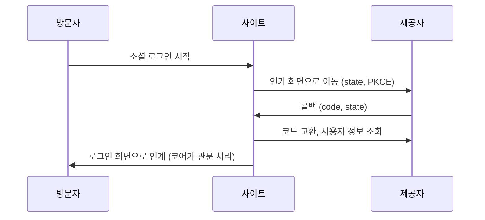
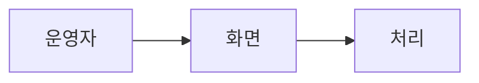

# 그누보드7 소셜 로그인 플러그인

**그누보드7 플러그인 · sirsoft-social_login**
카카오, 네이버, 구글, 페이스북과 일반 OIDC 제공자로 로그인하고 가입하는 플러그인. 본인 확인은 제공자가, 로그인 관문(잠금, 2단계 인증, 비밀번호 변경, 휴면 해제)은 코어가 맡는다.

<!-- @generated:badges START — ext:docgen 이 갱신. 이 블록 안은 직접 수정하지 않는다 -->
<p align="center">
  
  
  
  
</p>
<!-- @generated:badges END -->

---

[소개](#소개) · [주요 기능](#주요-기능) · [동작 방식](#동작-방식) · [요구 사항](#요구-사항) · [설치](#설치) · [관리자 설정](#관리자-설정) · [사용 방법](#사용-방법) · [다른 확장과의 연동](#다른-확장과의-연동) · [문서](#문서) · [트러블슈팅](#트러블슈팅) · [변경 이력](#변경-이력) · [라이선스](#라이선스)

---

## 소개

<!-- @intent START -->
방문자가 카카오, 네이버, 구글, 페이스북 또는 사이트가 등록한 OpenID Connect 제공자 계정으로 로그인하고 가입하게 하는 플러그인입니다. 본인 확인은 제공자가 하고, 로그인 관문(잠금, 2단계 인증, 비밀번호 변경, 휴면 해제)은 그누보드7 코어가 비밀번호 로그인과 똑같이 맡습니다. 1.0.0 에는 제공자 연동, 관리자 연결 테스트, 사이트 정책 설정이 들어 있고 로그인 버튼과 가입 화면은 다음 버전에서 열립니다.
<!-- @intent END -->

## 주요 기능

<!-- @intent START -->
| 영역 | 기능 |
|---|---|
| 제공자 | 카카오, 네이버, 구글, 페이스북 내장, 일반 OIDC(discovery) 커스텀 최대 10개 |
| 보안 | state 1회성, PKCE, OIDC nonce, id_token RS256 서명 검증, 같은 출처 복귀 주소만 허용, 콜백 뒤 세션 ID 재발급 |
| 관리자 | 연결 테스트(로그인하지 않고 받은 프로필 요약을 일회용 화면으로), 사이트 정책 설정 |
| 개발·검수 | 모의 제공자 5종(CLI 로만 켬, 최대 240분) |
| 확장 | 다른 확장이 필터 훅으로 제공자 추가 |

| 영역 | 설명 |
|---|---|
| - | - |
<!-- @intent END -->

## 동작 방식

<!-- @intent START -->



<!-- @intent END -->

## 요구 사항

<!-- @generated:requirements START — ext:docgen 이 갱신. 이 블록 안은 직접 수정하지 않는다 -->
| 항목 | 값 |
|---|---|
| 그누보드7 코어 | `>=7.2.0` |
| PHP | `^8.2` |
<!-- @generated:requirements END -->

## 설치

<!-- @generated:install START — ext:docgen 이 갱신. 이 블록 안은 직접 수정하지 않는다 -->
```bash
# 번들 설치 (코어에 동봉된 소스에서 설치)
php artisan plugin:install sirsoft-social_login

# 활성화
php artisan plugin:activate sirsoft-social_login

# 업데이트 (번들 소스 기준 강제 반영)
php artisan plugin:update sirsoft-social_login --force
```

저장소: https://github.com/gnuboard/g7-plugin-sirsoft-social_login
<!-- @generated:install END -->

## 관리자 설정

<!-- @generated:settings-summary START — ext:docgen 이 갱신. 이 블록 안은 직접 수정하지 않는다 -->
| 키 | 의미 | 기본값 |
|---|---|---|
| `email_conflict_policy` | 같은 이메일의 기존 회원 | `verify_link` |
| `extra_info_mode` | 가입 추가 정보 화면 | `when_missing` |
| `two_factor_enabled` | 소셜 로그인에도 2단계 인증 | `true` |
| `allow_admin_social_login` | 관리자 소셜 로그인 허용 | `false` |
| `allow_unlink_last_method` | 마지막 로그인 수단 해제 허용 | `false` |
| `webhook_unlink_policy` | 제공자 연결 해제 알림 처리 | `unlink_only` |
| `revoke_on_unlink` | 해제 때 제공자 권한 회수 | `true` |
| `profile_raw_retention_days` | 원본 프로필 보존(일) | `14` |
| `attempt_log_retention_days` | 시도 기록 보존(일) | `90` |
| `webhook_event_retention_days` | 웹훅 기록 보존(일) | `90` |
| `signup_surge_threshold_per_hour` | 가입 급증 알림 기준(시간당) | `100` |
| `provider_failure_streak_threshold` | 제공자 연속 실패 알림 기준 | `10` |
| `pending_signup_ttl_minutes` | 가입 대기 유효 시간(분) | `30` |
| `state_ttl_minutes` | 로그인 왕복 유효 시간(분) | `10` |
| `custom_provider_limit` | 커스텀 제공자 최대 수 | `10` |

개발자용 상세(타입·검증·저장 위치)는 [설정 스키마](docs/settings.md#설정-스키마) 를 보세요.
<!-- @generated:settings-summary END -->

<!-- @intent START -->
정책 기본값은 가장 보수적입니다. 「같은 이메일의 기존 회원」을 「바로 연결」로 바꾸면 제공자의 이메일 검증을 그대로 믿게 되므로, 그 제공자가 이메일 소유를 확인하는지 알 때만 고르세요. 시간 값(로그인 왕복, 가입 대기)을 줄이면 느린 회원이 제공자 화면에서 돌아왔을 때 실패가 늘어납니다.
<!-- @intent END -->

## 사용 방법

<!-- @intent START -->
1. **제공자 연결 확인**: 제공자 콘솔에 콜백 주소 `https://{사이트}/plugins/sirsoft-social_login/oauth/{제공자키}/callback` 를 등록하고, 연결 테스트를 돌려 결과 화면에 사용자 ID 와 이메일이 오는지 봅니다(테스트는 로그인하지 않습니다).
2. **개발 환경 확인**: `php artisan sirsoft-social_login:mock --enable --minutes=30` 으로 모의 제공자를 켜고 실제 제공자 앱 없이 왕복을 재고, 끝나면 `--disable` 합니다.
3. **정책 조정**: 플러그인 관리의 설정 화면에서 가입, 연결, 보존 기간을 정합니다.
<!-- @intent END -->

## 다른 확장과의 연동

<!-- @generated:integrations START — ext:docgen 이 갱신. 이 블록 안은 직접 수정하지 않는다 -->
**이 확장이 의존하는 확장**

없음 — 코어만으로 동작합니다.

**이 확장에 의존하는 확장** (이 확장을 비활성화하면 함께 영향을 받습니다)

없음.
<!-- @generated:integrations END -->

## 문서

<!-- @generated:docs-index START — ext:docgen 이 갱신. 이 블록 안은 직접 수정하지 않는다 -->
| 문서 | 내용 | 상태 |
|---|---|---|
| [docs/README.md](docs/README.md) | 문서 통합 목차와 실측 집계 | ✅ |
| [docs/architecture.md](docs/architecture.md) | 설계 의도·계층 지도·디렉토리 맵 | ✅ |
| [docs/extension-points.md](docs/extension-points.md) | 발행/구독 훅·미들웨어·채널·스케줄 | ✅ |
| [docs/data-model.md](docs/data-model.md) | 모델·소유 테이블·마이그레이션·Enum | ✅ |
| [docs/settings.md](docs/settings.md) | 설정 스키마·권한·메뉴·라우트·의존 관계 | ✅ |
| [docs/frontend.md](docs/frontend.md) | 레이아웃·액션 핸들러·전역 진입점·에셋 | ✅ |
| [docs/editor-spec.md](docs/editor-spec.md) | 레이아웃 편집기에 선언한 팔레트·컨트롤·샘플 데이터 | ✅ |
| [docs/api/](docs/api/README.md) | API 레퍼런스 (엔드포인트별 파라미터·응답 필드) | ✅ |
| [CHANGELOG.md](CHANGELOG.md) | 변경 이력 | ✅ |
<!-- @generated:docs-index END -->

## 트러블슈팅

<!-- @intent START -->
| 증상 | 원인 | 조치 |
|---|---|---|
| 연결 테스트 결과가 `KOE006`, `redirect_uri_mismatch` | 제공자 콘솔의 콜백 주소가 사이트 주소와 다름 | 콜백 주소를 사이트 주소(`APP_URL`) 기준으로 글자 그대로 등록 |
| 결과가 `state_invalid` | 제공자 화면에 오래 머물렀거나 같은 결과 주소를 다시 엶 | 테스트를 다시 시작(왕복 유효 시간 설정 확인) |
| 결과가 `id_token_*` | 발급자, 클라이언트 ID, 서버 시계가 맞지 않음 | OIDC discovery 주소와 클라이언트 ID 확인, 서버 시각 동기화 |
| 모의 제공자 주소가 404 | 모의 제공자가 꺼져 있음(정상) | 개발 환경에서만 `sirsoft-social_login:mock --enable` |

| 증상 | 원인 | 조치 |
|---|---|---|
| - | - | - |
<!-- @intent END -->

## 변경 이력

[CHANGELOG.md](CHANGELOG.md)

## 라이선스

MIT
