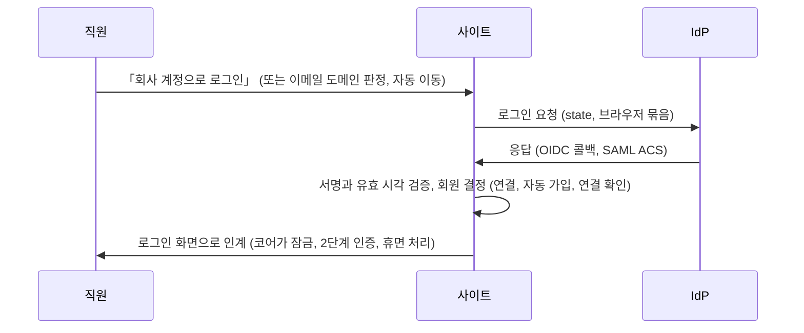
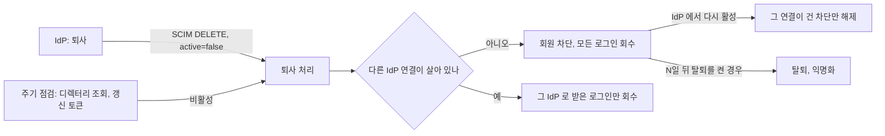

# 그누보드7 SSO 연동 플러그인

**그누보드7 플러그인 · sirsoft-sso**
회사 계정(SAML 2.0, OpenID Connect, LDAP/Active Directory)으로 로그인하고, SCIM 2.0 으로 회원을 만들고 지우는 기업용 SSO 플러그인. 로그인 관문(잠금, 2단계 인증, 비밀번호 변경, 휴면 해제)은 코어가 맡는다.

<!-- @generated:badges START — ext:docgen 이 갱신. 이 블록 안은 직접 수정하지 않는다 -->
<p align="center">
  
  
  
  
</p>
<!-- @generated:badges END -->

---

[소개](#소개) · [주요 기능](#주요-기능) · [동작 방식](#동작-방식) · [요구 사항](#요구-사항) · [설치](#설치) · [관리자 설정](#관리자-설정) · [사용 방법](#사용-방법) · [다른 확장과의 연동](#다른-확장과의-연동) · [문서](#문서) · [트러블슈팅](#트러블슈팅) · [변경 이력](#변경-이력) · [라이선스](#라이선스)

---

## 소개

<!-- @intent START -->
회사가 이미 쓰는 계정 서버(IdP — Keycloak, Entra ID, Okta, Google Workspace, AD FS, Active Directory 등)의 계정으로 그누보드7 에 로그인하게 하는 플러그인입니다. SAML 2.0, OpenID Connect, LDAP/Active Directory 세 방식을 지원하고, IdP 가 SCIM 2.0 으로 보내는 입사, 정보 변경, 퇴사를 회원에 반영합니다.

직원 전용 사이트, 고객 사이트에서 직원만 회사 계정으로 로그인하는 경우, 여러 회사가 각자 IdP 로 들어오는 B2B 사이트에 씁니다. 사이트 전체나 특정 도메인, 역할의 비밀번호 로그인을 막고 회사 계정으로만 들어오게 할 수 있으며, IdP 장애에 대비한 비상 계정을 둡니다.

본인 확인은 IdP 가 하고, 로그인 관문(잠금, 2단계 인증, 비밀번호 변경, 휴면 해제)은 코어가 비밀번호 로그인과 똑같이 맡습니다. 그누보드7 은 SP(서비스 제공자) 역할만 하며 IdP 가 되지 않습니다. 퇴사한 회원은 지우지 않고 차단합니다(게시글, 주문 기록 보존).
<!-- @intent END -->

## 주요 기능

<!-- @intent START -->
| 영역 | 설명 |
|---|---|
| 프로토콜 | OpenID Connect(discovery, PKCE, id_token 서명 검증, back-channel 로그아웃), SAML 2.0 SP(메타데이터 주소나 XML, 서명 필수, 단일 로그아웃, IdP 가 시작한 로그인 선택), LDAP/Active Directory(StartTLS, LDAPS, 이메일 또는 사내 아이디). IdP 최대 20개 |
| 로그인 진입 | 로그인 화면(사용자, 관리자)의 회사 계정 버튼, 이메일을 먼저 넣으면 도메인으로 회사 계정 안내, IdP 로 자동 이동(`?local=1` 로 비밀번호 화면 유지), IdP 가 시작한 로그인 |
| 회원 결정 | 처음 온 사람을 자동 가입 또는 사전 등록 회원만으로 받기, 자동 가입 약관 동의 선택, 기존 회원 연결 3방식(소유 도메인 자동, 비밀번호나 메일 인증번호로 본인 확인 뒤, 관리자 단건과 CSV) |
| 강제와 비상 계정 | 비밀번호 로그인 강제 4단위(IdP 소유 도메인, 역할, 회사 계정 연결 회원, 사이트 전체), 비상 계정(2단계 인증 필수, 로그인하면 알림), 콘솔 강제 해제 명령 |
| 프로비저닝 | SCIM 2.0(Users, Groups), 퇴사 처리 4방식(SCIM, 주기 점검, 다음 로그인 차단, 세션 수명 상한), 재활성, 퇴사 N일 뒤 탈퇴(익명화) |
| 회원 정보 | 항목별 동기화(덮어쓰기와 수정 잠금, 덮어쓰기, 처음만, 가져오지 않음), 부서, 직급, 사번 같은 추가 속성, IdP 그룹 → 역할 매핑 |
| 세션 | 세션 수명 상한, 로그아웃 범위(G7 만, G7 에서 IdP 까지, 양방향), 2단계 인증 생략 방식 IdP 별 선택 |
| 관리자 | 설정 화면(IdP 목록과 편집, 정책, 보존), IdP 콘솔에 넣을 값 복사, 연결 테스트, 브라우저 로그인 테스트, 「회원 연결」 화면(연결 추가, 사전 등록, CSV 가져오기), 「이력」 화면(로그인 시도, SCIM 수신) |
| 회원 화면 | 관리자 회원 상세 「SSO」 탭, 회원 목록 IdP 필터와 부서, 직급 열, 마이페이지 「연결된 회사 계정」 카드, 메일 없는 회원의 회사 계정 재확인 |
| 운영 | 알림 7종, 활동 로그, 스케줄 4종, LDAP 진단 명령, 개발용 모의 IdP(OpenID Connect, SAML) |
<!-- @intent END -->

## 동작 방식

<!-- @intent START -->


LDAP/Active Directory 는 리디렉션 없이 로그인 화면의 아이디와 비밀번호를 사이트가 디렉터리 서버에 확인합니다.


<!-- @intent END -->

## 요구 사항

<!-- @generated:requirements START — ext:docgen 이 갱신. 이 블록 안은 직접 수정하지 않는다 -->
| 항목 | 값 |
|---|---|
| 그누보드7 코어 | `>=7.2.1` |
| PHP | `^8.2` |
| PHP 확장(필수) | `openssl`, `dom`, `zlib` |
| PHP 확장(권장) | `ldap` — LDAP/Active Directory 로그인과 재직 조회에 필요합니다. 없으면 LDAP 드라이버만 사용할 수 없습니다. |
<!-- @generated:requirements END -->

## 설치

<!-- @generated:install START — ext:docgen 이 갱신. 이 블록 안은 직접 수정하지 않는다 -->
```bash
# 번들 설치 (코어에 동봉된 소스에서 설치)
php artisan plugin:install sirsoft-sso

# 활성화
php artisan plugin:activate sirsoft-sso

# 업데이트 (번들 소스 기준 강제 반영)
php artisan plugin:update sirsoft-sso --force
```

저장소: https://github.com/gnuboard/g7-plugin-sirsoft-sso
<!-- @generated:install END -->

## 관리자 설정

<!-- @generated:settings-summary START — ext:docgen 이 갱신. 이 블록 안은 직접 수정하지 않는다 -->
관리자 설정 화면이 있습니다 (레이아웃: `resources/layouts/admin/plugin_settings.g7.html`). 설정 항목은 화면에서 확인하세요. 경로: `/admin/plugins/sirsoft-sso/settings`
<!-- @generated:settings-summary END -->

<!-- @intent START -->
설정은 코어 설정 키가 아니라 이 플러그인 화면 하나(탭 「IdP」, 「정책」, 「보존」)에서 저장합니다.

- **IdP 편집**(하위 탭 기본, 연결 정보, 계정과 연결, 속성, 역할 매핑, 보안, 프로비저닝, 진단): 「연결 정보」의 「IdP 콘솔에 넣을 값」을 IdP 에 등록하고, 연결 테스트와 브라우저 로그인 테스트가 통과한 뒤 켭니다. 「계정과 연결」의 소유 도메인 자동 연결은 그 IdP 가 그 도메인의 주인일 때만 켜세요. 같은 이메일 회원에게 확인 없이 붙습니다(관리자 계정은 제외).
- **정책**: 강제를 켜거나 넓히면 저장 전에 「비밀번호 로그인을 못 하게 되는 회원 수」와 「로그아웃될 세션 수」가 나오고, 저장하면 그 회원들의 비밀번호 로그인 세션이 끝납니다. 사이트 전체 강제, 역할 강제, 비상 계정은 최고관리자만 바꿉니다. 사이트 전체 강제를 켜면 셀프 가입도 닫힙니다. 자동 이동 IdP 는 사이트 전체 강제가 켜져 있을 때만 동작합니다.
- **보존**: 로그인 시도(기본 90일), SCIM 수신(90일), 끝난 세션(30일) 보존 기간, IdP 연속 실패 알림 기준(10분 안 5회), 인증서 만료 알림(30일, 7일 전), 로그인 요청과 동의, 연결 확인 대기 시간(10분)을 정합니다. 대기 시간을 줄이면 IdP 화면에 오래 머문 직원의 로그인이 실패합니다.
<!-- @intent END -->

## 사용 방법

<!-- @intent START -->
1. **IdP 등록**: 플러그인 관리 → SSO 연동 설정의 「IdP」 탭에서 [IdP 추가]로 프로토콜을 고르고, 「연결 정보」에 IdP 메타데이터 주소(SAML), discovery 주소와 클라이언트 ID, 비밀값(OIDC), 디렉터리 주소와 서비스 계정(LDAP)을 넣습니다. 같은 탭의 「IdP 콘솔에 넣을 값」(SP Entity ID, ACS, SLS, 메타데이터 주소, Redirect URI, back-channel 주소)을 IdP 관리 콘솔에 붙여 넣습니다.
2. **확인과 활성화**: 「진단」에서 연결 테스트와 브라우저 로그인 테스트(로그인하지 않고 받은 신원만 보여 줌)를 하고, 「계정과 연결」에서 처음 온 사람 처리(자동 가입 또는 사전 등록 회원만)와 소유 도메인을 정한 뒤 「기본」에서 켭니다.
3. **기존 회원 잇기**: 관리자 메뉴 「SSO 연동 → 회원 연결」에서 한 명씩 연결하거나 CSV(`email,name,idp_key,subject`, 최대 1000행)를 미리보기 뒤 가져옵니다. 회원이 없으면 비밀번호 없이 만들어 연결합니다.
4. **입사와 퇴사 반영**: 「프로비저닝」에서 SCIM 을 켜고 [SCIM 토큰 발급](한 번만 보임)으로 받은 토큰과 엔드포인트 주소를 IdP 에 넣습니다. SCIM 을 쓰지 않으면 주기 점검이나 세션 수명 상한을 켭니다.
5. **강제**: 「정책」에서 비상 계정을 확인하고(비밀번호와 2단계 인증 수단이 있는 계정) 강제 단위를 켭니다. 잠겼을 때는 서버에서 `php artisan sirsoft-sso:enforcement --disable` 로 풉니다.
6. **운영 확인**: 「SSO 연동 → 이력」에서 로그인 시도와 SCIM 수신을 보고, 회원 상세의 「SSO」 탭에서 연결, 추가 속성, 역할 출처를 봅니다. 퇴사 반영과 이력 정리는 서버 스케줄러가 돌아야 합니다.

IdP 제품별 콘솔 등록 절차(Keycloak, Entra ID, Okta, Google Workspace, AD FS, Active Directory), SCIM 토큰과 대조 키 고르기, 비상 계정과 강제 해제, 플러그인을 끌 때 생기는 일, `APP_KEY` 교체, LDAP 설정, 주기 점검의 프로토콜별 한계, 알림, 모의 IdP 는 [운영자 가이드](docs/operator-guide.md) 에 있습니다.
<!-- @intent END -->

## 다른 확장과의 연동

<!-- @generated:integrations START — ext:docgen 이 갱신. 이 블록 안은 직접 수정하지 않는다 -->
**이 확장이 의존하는 확장**

없음 — 코어만으로 동작합니다.

**이 확장에 의존하는 확장** (이 확장을 비활성화하면 함께 영향을 받습니다)

없음.
<!-- @generated:integrations END -->

## 문서

<!-- @generated:docs-index START — ext:docgen 이 갱신. 이 블록 안은 직접 수정하지 않는다 -->
| 문서 | 내용 | 상태 |
|---|---|---|
| [docs/README.md](docs/README.md) | 문서 통합 목차와 실측 집계 | ✅ |
| [docs/architecture.md](docs/architecture.md) | 설계 의도·계층 지도·디렉토리 맵 | ✅ |
| [docs/extension-points.md](docs/extension-points.md) | 발행/구독 훅·미들웨어·채널·스케줄 | ✅ |
| [docs/data-model.md](docs/data-model.md) | 모델·소유 테이블·마이그레이션·Enum | ✅ |
| [docs/settings.md](docs/settings.md) | 설정 스키마·권한·메뉴·라우트·의존 관계 | ✅ |
| [docs/frontend.md](docs/frontend.md) | 레이아웃·액션 핸들러·전역 진입점·에셋 | ✅ |
| [docs/editor-spec.md](docs/editor-spec.md) | 레이아웃 편집기에 선언한 팔레트·컨트롤·샘플 데이터 | ✅ |
| [docs/api/](docs/api/README.md) | API 레퍼런스 (엔드포인트별 파라미터·응답 필드) | ✅ |
| [CHANGELOG.md](CHANGELOG.md) | 변경 이력 | ✅ |
<!-- @generated:docs-index END -->

## 트러블슈팅

<!-- @intent START -->
| 증상 | 원인 | 조치 |
|---|---|---|
| 모든 SAML 로그인이 `saml_invalid`, 연결 테스트의 `site_url` 항목 실패 | 사이트 호스트 이름에 밑줄(`_`)이 있어 SAML 라이브러리가 주소를 거부 | 밑줄 없는 호스트로 사이트 주소(`APP_URL`)를 바꾼다 |
| SAML 로그인이 `bind_mismatch` | 사이트가 `https` 가 아니라 IdP 의 교차 사이트 POST 에 묶음 쿠키가 실리지 않음 | 사이트를 `https` 로 운영 |
| `state_expired`, `pending_expired`, `link_expired` | IdP 화면이나 동의 창에 대기 시간(기본 10분)보다 오래 머묾 | 다시 시작. 자주 나면 「보존」 탭의 대기 시간을 늘림 |
| `not_registered` | 처음 온 사람인데 IdP 가 「사전 등록 회원만」 | 「회원 연결」에서 사전 등록하거나 자동 가입으로 바꿈 |
| `deprovisioned` | 그 연결이 SCIM 이나 관리자에 의해 퇴사 처리됨 | IdP 에서 다시 활성(SCIM `active=true`)하거나 관리자가 연결을 정리 |
| `id_token_invalid` | 발급자, 클라이언트 ID, 서버 시계(허용 오차 120초)가 맞지 않음 | discovery 주소와 클라이언트 ID 확인, 서버 시각 동기화 |
| 비밀번호 로그인이 「회사 계정으로 로그인하세요」로 막힘 | 강제 대상(도메인, 역할, 연결 회원, 사이트 전체) | 회사 계정으로 로그인. IdP 장애면 비상 계정으로 들어가거나 `sirsoft-sso:enforcement --disable` |
| LDAP 로그인이 「사내 계정 서버에 연결할 수 없습니다」 | 서버에 PHP LDAP 확장이 없거나 디렉터리에 닿지 못함, 그 LDAP IdP 가 꺼짐 | `php artisan sirsoft-sso:ldap-test {IdP 키}` 로 연결, TLS, 서비스 바인드를 확인 |
| 퇴사한 직원이 계속 로그인됨 | SCIM 이 꺼져 있거나 큐, 스케줄러가 멈춰 주기 점검이 돌지 않음 | 「이력 → SCIM 수신」에 요청이 오는지, 서버 스케줄러가 도는지 확인 |
| SCIM 요청이 401, 403 | 토큰이 틀림(다시 발급하면 이전 토큰은 무효), 또는 그 IdP 의 SCIM 이 꺼져 있음 | 토큰을 다시 발급해 IdP 에 넣고 「프로비저닝」의 SCIM 사용을 켬 |
| IdP 설정 화면이나 로그인이 비밀값을 읽다 실패 | 사이트 앱 키(`APP_KEY`)를 바꿈 | [운영자 가이드](docs/operator-guide.md#4-비밀값과-앱-키app_key) 대로 이전 키를 `APP_PREVIOUS_KEYS` 에 두고 비밀값을 다시 저장 |
<!-- @intent END -->

## 변경 이력

[CHANGELOG.md](CHANGELOG.md)

## 라이선스

MIT
