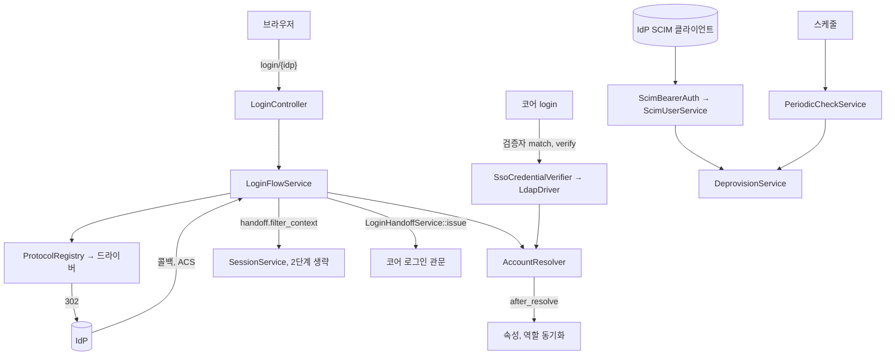

# SSO 연동 — 아키텍처

> 설계 의도와 계층 구조 · 진입점: [AGENTS.md](../AGENTS.md)

## 설계 의도

<!-- @intent START -->
본인 확인(IdP)과 로그인(코어)을 나눈다. 플러그인은 IdP 왕복과 응답 검증, 회원-IdP 연결, 프로비저닝, 강제 정책을 소유하고, 토큰은 코어 로그인 인계(OIDC, SAML)와 코어 외부 자격 증명 검증자(LDAP)로만 만든다.

프로토콜마다 다른 부분은 `Contracts\ProtocolDriverInterface` 를 구현한 드라이버 하나에 모은다(시작, 응답 검증, 로그아웃, 연결 테스트, IdP 콘솔에 넣을 값). 아이디와 비밀번호를 받는 방식은 `CredentialDriverInterface`(`authenticate`, `lookup`)를 더 구현한다. 공통 흐름(state, 묶음 쿠키, 회원 결정, 인계, 실패 기록)은 `LoginFlowService` 와 `AccountResolver` 가 맡는다. 드라이버 목록은 `ProtocolRegistry` 가 내장 셋(oidc, saml, ldap)과 필터 `sirsoft-sso.protocol.filter_registered` 를 합쳐 만들고, 서버에 필요한 PHP 확장이 없으면 드라이버가 `isAvailable() = false` 를 돌려 그 프로토콜만 쓰지 못한다(LDAP 의 `ext-ldap`).

서명 검증은 검증된 외부 라이브러리에 맡긴다 — SAML 은 `onelogin/php-saml`(내부 `robrichards/xmlseclibs`), JWT 는 `firebase/php-jwt`. 이 두 패키지 때문에 플러그인이 vendor-bundle 을 함께 싣는다. 외부 의존은 PHP `openssl`, `dom`, `zlib` 확장이고 `ext-ldap` 은 선택이다.

세 영역은 서로의 파일을 고치지 않고 더할 수 있게 이음매 클래스로 모은다 — `Bootstrap\Listeners`, `Bootstrap\Commands`, `Bootstrap\Schedules`, `Bootstrap\Tables`, `Bootstrap\Container`(저장소 바인딩, 플러그인 캐시 주입 서비스, 요청 단위 싱글턴)가 영역별 파일(`CoreFlow`, `Oidc`, `Saml`, `Ldap`, `Provisioning`, `Policy`, `Admin`)의 `all()` 을 합친다. 라우트도 `src/routes/web/*.php`, `src/routes/api/*.php` 영역 파일로 나뉜다. 플러그인 캐시가 필요한 서비스는 `cacheServices()` 에 올려야 한다 — 빠뜨리면 코어 전역 캐시가 주입된다.

정책과 IdP 설정은 코어 설정이 아니라 플러그인 표와 플러그인 API 로 저장한다. 최고관리자 전용 칸을 서비스에서 검사하고, 코어 설정 저장 경로로 같은 값을 우회 저장할 수 없게 하려는 것이다.
<!-- @intent END -->

## 계층 지도

<!-- @intent START -->
| 계층 | 클래스 |
|---|---|
| 웹 진입(브라우저, IdP) | `LoginController`(start, testResult), `OidcController`(callback), `SamlController`(metadata, acs, sls), `LogoutController`(start, return), `BackchannelController`, `Mock\Oidc\MockOidcController`, `Mock\Saml\MockSamlController` |
| API 진입 | `PublicIdpController`, `PendingController`, `LinkController`, `MeController`, `Admin\IdpController`, `Admin\PolicyController`, `Admin\AccountController`, `Admin\LogController`, `Scim\ScimUserController`, `Scim\ScimGroupController`, `Scim\ScimDiscoveryController` |
| 미들웨어 | `ScimBearerAuth`(SCIM 토큰과 수신 이력), `Mock\MockGateMiddleware`(모의 IdP 게이트, 꺼지면 404), 코어 `AddQueuedCookiesToResponse`(api 응답에 묶음 쿠키를 싣기) |
| 요청 검증 | `Http\Requests\*`(흐름), `Http\Requests\Admin\*`, `Http\Requests\Scim\*`, `Http\Requests\Me\LinkStartRequest` |
| 흐름 | `LoginFlowService`(시작, 콜백, 인계, 시작 티켓, 재확인 완료, 테스트 결과), `StateStore`(state, 묶음 쿠키, 시작 티켓), `PendingStore`(동의, 연결 확인 대기), `AccountResolver`(회원 결정), `LinkVerificationService`(동의, 연결 확인 완료), `SafeRedirect`(같은 출처 경로) |
| 드라이버 | `Drivers\Oidc\OidcDriver`(`IdTokenValidator`, `OidcMetadata`), `Drivers\Saml\SamlDriver`(`SamlSpService`, `SamlMetadata`, `SamlEnvironment`, `X509KeyPair`), `Drivers\Ldap\LdapDriver`(`Services\Ldap\DirectoryClientInterface` ← `ExtLdapDirectoryClient`) ← `ProtocolRegistry` |
| 코어 연결 | `Services\Ldap\SsoCredentialVerifier`(코어 외부 자격 증명 검증자, id `sirsoft-sso`), `Identity\SsoReauthIdentityProvider`(코어 본인인증 수단 「회사 계정으로 재확인」, id `sirsoft-sso`) |
| 정책 | `Services\Policy\PolicyService`(정책 읽기, 저장, 영향), `EnforcementPolicy`(비밀번호 인증 판정), `DiscoveryService`(이메일 먼저 입력, 자동 이동), `EmergencyAccess`(비상 계정) |
| 프로비저닝 | `Services\Provisioning\ScimUserService`, `ScimGroupService`, `ScimFilter`, `ScimSchema`, `ScimUserPayload`, `DeprovisionService`(퇴사, 재활성, N일 뒤 탈퇴), `PeriodicCheckService` |
| 동기화와 세션 | `RoleSyncService`, `RoleSyncRuleValidator`(관리자 역할 규칙은 최고관리자만), `AttributeSyncService`(속성, 이메일, 칸 잠금), `AttributeQuery`(다른 확장용 공개 조회), `SessionService`(세션 기록, 상한, 로그아웃 범위, IdP 발 로그아웃) |
| 관리자 | `Services\Admin\IdpAdminService`, `AccountAdminService`, `CsvImportService`, `LogAdminService`, `MyAccountService`(마이페이지 카드) |
| 리스너 | 코어 로그인 관문 필터(강제, 진입, 자동 이동, 가입 닫기, 칸 잠금, 로그아웃 이동), 인계 문맥(2단계 생략, 세션), 회원 탈퇴, 삭제 정리, 관리자 회원 화면 주입, 알림 값, 활동 로그, IdP 연속 실패 감시, 재확인 수단과 검증자 등록 |
| 명령 | `EnforcementCommand`, `MockCommand`, `Mock\Saml\MockSamlCommand`, `Drivers\Ldap\LdapTestCommand`, `Drivers\Saml\MetadataRefreshCommand`, `Provisioning\DeprovisionCheckCommand`, `WithdrawDeprovisionedCommand`, `PruneCommand` |
| 저장 | Repository 13종(인터페이스 + 구현, 관리자 화면 조회는 `Repositories\Policy\*`) → 모델 9종 |

<!-- @intent END -->

## 디렉토리

<!-- @generated:directory-map START — ext:docgen 이 갱신. 이 블록 안은 직접 수정하지 않는다 -->
| 경로 | 역할 | 수정 시 필요한 절차 |
|---|---|---|
| `plugin.json` | manifest (버전 SSoT) | version 변경 시 package.json·package-lock.json·composer.json 동기화 |
| `plugin.php` | 진입 클래스 (선언형 표면 SSoT) | 표면 변경 시 `ext:docgen` 재실행 + 코어 최소 버전 검토 |
| `src/Http/Controllers/` | 컨트롤러 | API 표면 변경 시 `api:docgen` 재실행 |
| `src/Http/Requests/` | FormRequest (검증 SSoT) | 검증 규칙은 Service 가 아니라 여기에 둔다 |
| `src/Services/` | 비즈니스 로직 | Repository 인터페이스 주입 (구체 클래스 금지) |
| `src/Repositories/` | 데이터 접근 | 목록 쿼리는 컬럼 프루닝·정렬 화이트리스트 확인 |
| `src/Models/` | Eloquent 모델 | 스키마 변경 시 마이그레이션 + 업그레이드 스텝 동반 |
| `src/Listeners/` | 훅 리스너 | Repository 경유 (Model·DB 파사드 직접 접근 금지) |
| `src/routes/` | 라우트 | 모든 라우트에 `name()` 필수 |
| `database/migrations/` | 마이그레이션 | 한국어 comment + `down()` 필수, 기설치본은 업그레이드 스텝으로 백필 |
| `resources/layouts/` | 레이아웃 소스 `.g7.html` (짝 `.json` 은 굽기 산출. 컴포넌트 종류는 `data-type`, 컴파일은 템플릿과 무관) | `php artisan plugin:update sirsoft-sso --force` (빌드 불필요) |
| `resources/routes.json` | 라우트 → 레이아웃 매핑 | `php artisan plugin:update sirsoft-sso --force` |
| `resources/js/` | 프론트 엔트리·핸들러 | `php artisan plugin:build` → `php artisan plugin:update sirsoft-sso --force` |
| `resources/extensions/` | 다른 확장 레이아웃에 주입하는 조각 | `php artisan plugin:update sirsoft-sso --force` |
| `editor-spec.json` | 레이아웃 편집기 스펙 | `php artisan plugin:update sirsoft-sso --force` |
| `dist/` | 커밋되는 빌드 산출물 | `--production` 으로 재빌드 (sourceMappingURL 잔존 금지) |
| `tests/` | 테스트 | 변경 범위만 필터 실행 |
| `CHANGELOG.md` | 변경 이력 | 버전 상향 시 항목 추가 (미기재 시 버전 상향 불가) |
| `components.json` | 편집기 컴포넌트 선언 (레이아웃 작성자가 읽는 props 계약) | `php artisan plugin:update sirsoft-sso --force` |
| `assets/icon.svg` | 확장 아이콘 (관리자 목록·설치 마법사 카드) | 정사각·100KB 이하·스크립트 없는 SVG — 교체 후 `php artisan plugin:update sirsoft-sso --force` |
| `docs/` | 개발자 문서 | 표면 변경 시 `php artisan ext:docgen` 재실행 |
| `lang/` | 다국어 | 키 추가 시 ko·en 동시 반영 + 번들 ja 팩 동기화 |
<!-- @generated:directory-map END -->
