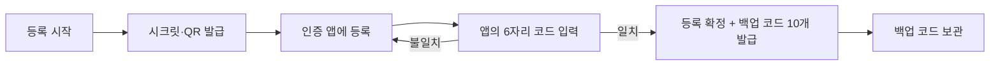
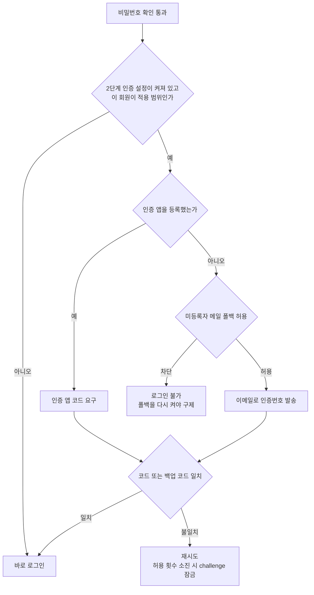
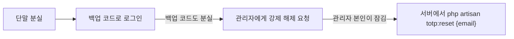

# 그누보드7 인증 앱 2단계 인증 (TOTP) 플러그인

**그누보드7 플러그인 · sirsoft-totp**
인증 앱이 만드는 6자리 코드(RFC 6238 TOTP)로 로그인 2단계 인증을 받는 플러그인. G7 코어 IDV 인프라에 Provider 로 등록된다.

<!-- @generated:badges START — ext:docgen 이 갱신. 이 블록 안은 직접 수정하지 않는다 -->
<p align="center">
  
  
  
  
</p>
<!-- @generated:badges END -->

---

[소개](#소개) · [주요 기능](#주요-기능) · [동작 방식](#동작-방식) · [요구 사항](#요구-사항) · [설치](#설치) · [관리자 설정](#관리자-설정) · [사용 방법](#사용-방법) · [다른 확장과의 연동](#다른-확장과의-연동) · [문서](#문서) · [트러블슈팅](#트러블슈팅) · [변경 이력](#변경-이력) · [라이선스](#라이선스)

---

## 소개

<!-- @intent START -->
로그인 2단계 인증을 **인증 앱**으로 받게 해 주는 플러그인입니다. 회원이 Google
Authenticator·Authy·1Password 같은 앱에 사이트를 한 번 등록해 두면, 비밀번호를 맞게
입력한 다음 앱에 떠 있는 6자리 코드를 추가로 요구합니다.

**무엇을 해결하는가**: 그누보드7 기본 2단계 인증 수단은 이메일뿐입니다. 메일 발송이
막히면 로그인도 함께 막히고, 회원의 메일 계정이 뚫리면 2단계 인증이 사실상 없는 것과
같아집니다. 인증 앱은 코드를 **서버가 보내지 않고 회원 단말이 직접 만들기** 때문에 두
문제가 모두 없습니다. 인터넷이 끊긴 단말에서도 코드가 만들어집니다.

**어떤 상황에 쓰는가**: 관리자 계정이 뚫리면 사이트 전체가 넘어가는 운영 환경, 메일
발송이 불안정한 사이트, 또는 회원에게 이메일 주소를 요구하지 않는 사이트에 씁니다.
코어 「설정 > 보안」의 2단계 인증 적용 범위를 `관리자` 로 두면 관리자에게만 요구할 수
있습니다.

**의도적으로 하지 않는 것**:

- **로그인 화면을 바꾸지 않습니다.** 코드를 입력받는 화면은 그누보드7 코어의 2단계 인증
  화면 그대로이고, 이 플러그인은 그 화면에 들어갈 수단 하나를 더할 뿐입니다.
- **회원가입·비밀번호 재설정에는 쓰이지 않습니다.** 아직 앱을 등록하지 않은 시점이라
  인증 앱으로는 본인을 확인할 수 없습니다. 로그인 2단계 인증 전용입니다.
- **코드 자릿수·갱신 주기를 설정으로 열지 않습니다.** 6자리 / 30초 / SHA1 고정입니다 —
  주요 인증 앱이 이 조합만 QR 로 정확히 읽습니다.
- **시크릿과 백업 코드를 다시 보여 주지 않습니다.** 등록·재발급 시점에 한 번만 보여 주고,
  이후 어떤 화면·API 로도 다시 조회할 수 없습니다.
<!-- @intent END -->

## 주요 기능

<!-- @intent START -->
| 영역 | 설명 |
|---|---|
| 로그인 2단계 인증 | 비밀번호 확인 뒤 인증 앱의 6자리 코드를 추가로 요구합니다. 코드 확인은 코어 2단계 인증 화면이 그대로 처리합니다 |
| 인증 앱 등록 | QR 코드(otpauth URI)나 직접 입력용 키를 발급하고, 앱이 만든 첫 코드를 확인해 등록을 확정합니다 |
| 백업 코드 | 확정 시 `xxxxx-xxxxx` 형식 10개를 발급합니다. 단말을 잃었을 때 코드 대신 쓰며, 한 번 쓴 코드는 즉시 소진됩니다 |
| 백업 코드 재발급 | 현재 코드나 남은 백업 코드로 본인을 확인한 뒤 10개를 새로 발급합니다. 이전 코드는 전부 무효가 됩니다 |
| 등록 해제 | 회원 본인이 현재 코드(또는 백업 코드)를 넣어 해제합니다 — 자리를 비운 사이 열린 세션으로 2단계 인증이 꺼지는 것을 막습니다 |
| 관리자 강제 해제 | 단말과 백업 코드를 모두 잃은 회원을 위해 코드 확인 없이 등록을 해제합니다. 전용 권한(`sirsoft-totp.credentials.delete`)이 필요하며 실행 시 훅이 발행됩니다 |
| 서버 최후 구제 | `php artisan totp:reset {email}` — 관리자 본인이 잠겨 관리자 화면에 못 들어갈 때의 유일한 탈출구 |
| 미등록자 메일 폴백 | 아직 앱을 등록하지 않은 회원은 기존대로 이메일로 인증번호를 받습니다. 설정으로 끌 수 있습니다 |
| 리플레이 방지 | 한 번 통과한 코드는 유효 시간이 남아 있어도 다시 통과하지 않습니다 |
| 저장 보호 | 시크릿은 암호화 저장, 백업 코드는 해시 저장. 평문은 발급 응답에만 한 번 실립니다 |
| 탈퇴·삭제 연동 | 회원이 탈퇴하거나 삭제되면 자격증명이 함께 파기됩니다 |
<!-- @intent END -->

## 동작 방식

<!-- @intent START -->
**회원이 인증 앱을 등록하는 과정** — 시크릿과 백업 코드는 화면에 뜨는 그 순간이 유일한
노출 기회입니다.



**로그인할 때 어떤 수단이 쓰이는가** — 앱을 등록하지 않은 회원도 잠기지 않도록, 코어가
메일로 되돌려 보냅니다(메일 폴백을 끄면 로그인이 막힙니다).



**단말을 잃었을 때의 구제 경로** — 위쪽일수록 먼저 시도합니다.


<!-- @intent END -->

## 요구 사항

<!-- @generated:requirements START — ext:docgen 이 갱신. 이 블록 안은 직접 수정하지 않는다 -->
| 항목 | 값 |
|---|---|
| 그누보드7 코어 | `>=7.1.0` |
| PHP | `^8.2` |
<!-- @generated:requirements END -->

## 설치

<!-- @generated:install START — ext:docgen 이 갱신. 이 블록 안은 직접 수정하지 않는다 -->
```bash
# 번들 설치 (코어에 동봉된 소스에서 설치)
php artisan plugin:install sirsoft-totp

# 활성화
php artisan plugin:activate sirsoft-totp

# 업데이트 (번들 소스 기준 강제 반영)
php artisan plugin:update sirsoft-totp --force
```

저장소: https://github.com/gnuboard/g7-plugin-sirsoft-totp
<!-- @generated:install END -->

## 관리자 설정

<!-- @generated:settings-summary START — ext:docgen 이 갱신. 이 블록 안은 직접 수정하지 않는다 -->
| 키 | 의미 | 기본값 |
|---|---|---|
| `issuer` | 발급자 표기 | - |
| `allow_mail_fallback` | 미등록자 메일 폴백 허용 | `true` |

개발자용 상세(타입·검증·저장 위치)는 [설정 스키마](docs/settings.md#설정-스키마) 를 보세요.
<!-- @generated:settings-summary END -->

<!-- @intent START -->
**`issuer`(발급자 표기)** — 인증 앱 목록에 표시될 사이트 이름입니다. 비워 두면 사이트
이름(`app.name`)을 씁니다. 한 사람이 여러 사이트를 같은 앱에 등록하면 목록에서 어느
사이트 코드인지 구분되지 않으므로, 사이트 이름이 길거나 불명확할 때 짧고 알아보기 쉬운
이름으로 바꿉니다. 이미 등록을 마친 회원의 앱에 표시된 이름은 **바뀌지 않습니다** — 등록
시점의 QR 에 구워진 값이라, 새로 등록하는 회원부터 적용됩니다. 64자까지 넣을 수 있습니다.

**`allow_mail_fallback`(미등록자 메일 폴백 허용)** — 기본값은 허용입니다. 켜져 있으면
인증 앱을 등록하지 않은 회원은 기존대로 이메일로 인증번호를 받습니다. 끄면 그 회원들은
**등록을 마칠 때까지 로그인할 수 없습니다** — 이미 로그인한 세션으로 등록을 마칠 수는
있지만, 등록하지 않은 채 로그아웃된 회원은 이 설정을 다시 켜기 전까지 들어올 길이 없습니다
(해제할 등록이 없으므로 관리자 강제 해제나 `totp:reset` 은 구제가 되지 않습니다 — 이 둘은 등록을
없애 주는 수단이라, 폴백이 꺼진 동안에는 해제된 회원도 같은 이유로 막힙니다).
"메일 계정이 뚫려도 2단계 인증은 뚫리지 않는다"를 보장해야 하는 사이트만 끄고, 끄기
전에 대상 회원 전원이 등록을 마쳤는지 먼저 확인하세요.

두 값 모두 저장 즉시 다음 요청부터 반영됩니다.

코드 자릿수(6)·갱신 주기(30초)·해시 알고리즘(SHA1)은 설정에 없습니다 — 인증 앱
호환성 때문에 고정입니다.
<!-- @intent END -->

## 사용 방법

<!-- @intent START -->
**관리자에게만 인증 앱 2단계 인증을 요구하기**

1. 플러그인을 설치·활성화합니다. 설치 시 「설정 > 본인인증」의 로그인 목적 수단이 비어
   있으면 `totp` 로 한 번 채워집니다 — 이미 다른 수단이 지정돼 있으면 운영자 선택이므로
   덮어쓰지 않습니다.
2. 코어 「설정 > 보안」에서 2단계 인증을 켜고 적용 범위를 `관리자` 로 둡니다.
3. 관리자 메뉴 「인증 앱 등록」에서 본인 계정을 등록합니다 — QR 을 앱으로 읽고, 앱에
   뜬 6자리 코드를 입력해 확정합니다.
4. 화면에 뜬 백업 코드 10개를 별도 매체에 보관합니다. **이 화면을 벗어나면 다시 볼 수
   없습니다.**
5. 로그아웃 후 다시 로그인해 코드를 요구받는지 확인합니다.

**회원이 단말을 바꿀 때**

1. 회원이 이전 단말이 아직 있다면: 현재 코드로 등록을 해제한 뒤 새 단말에서 다시
   등록합니다. 해제하지 않고 새로 등록하려 하면 거부됩니다(이미 등록됨).
2. 이전 단말이 없다면: 보관해 둔 백업 코드로 로그인한 뒤 해제 → 재등록합니다.
3. 둘 다 없다면 아래 항목으로 갑니다.

**단말과 백업 코드를 모두 잃은 회원 구제하기**

1. `sirsoft-totp.credentials.delete` 권한을 가진 관리자가 대상 회원의 등록을 강제
   해제합니다. 코드 확인 없이 해제되는 경로이므로, 이 권한은 회원 관리 권한과 분리된
   전용 권한(역할 「인증 앱 운영자」)입니다 — 본인 확인 절차는 운영 정책으로 갖추세요.
2. 해제 직후 `sirsoft-totp.credential.admin_reset` 훅이 발행되므로, 누가 누구의 2단계
   인증을 풀었는지 기록할 확장을 붙일 수 있습니다.
3. 관리자 본인이 잠겨 관리자 화면에 들어갈 수 없다면 서버에서
   `php artisan totp:reset {email}` 을 실행합니다.
4. 해제된 회원은 다음 로그인부터 코드를 요구받지 않습니다(메일 폴백이 켜져 있으면
   이메일로 받습니다). 다시 등록하도록 안내하세요.

전체 API 목록은 [docs/api/](docs/api/README.md) 를, 발행·구독 훅 목록은
[docs/extension-points.md](docs/extension-points.md) 를 참고하세요.
<!-- @intent END -->

## 다른 확장과의 연동

<!-- @generated:integrations START — ext:docgen 이 갱신. 이 블록 안은 직접 수정하지 않는다 -->
**이 확장이 의존하는 확장**

없음 — 코어만으로 동작합니다.

**이 확장에 의존하는 확장** (이 확장을 비활성화하면 함께 영향을 받습니다)

없음.
<!-- @generated:integrations END -->

## 문서

<!-- @generated:docs-index START — ext:docgen 이 갱신. 이 블록 안은 직접 수정하지 않는다 -->
| 문서 | 내용 | 상태 |
|---|---|---|
| [docs/README.md](docs/README.md) | 문서 통합 목차와 실측 집계 | ✅ |
| [docs/architecture.md](docs/architecture.md) | 설계 의도·계층 지도·디렉토리 맵 | ✅ |
| [docs/extension-points.md](docs/extension-points.md) | 발행/구독 훅·미들웨어·채널·스케줄 | ✅ |
| [docs/data-model.md](docs/data-model.md) | 모델·소유 테이블·마이그레이션·Enum | ✅ |
| [docs/settings.md](docs/settings.md) | 설정 스키마·권한·메뉴·라우트·의존 관계 | ✅ |
| [docs/frontend.md](docs/frontend.md) | 레이아웃·액션 핸들러·전역 진입점·에셋 | ✅ |
| [docs/editor-spec.md](docs/editor-spec.md) | 레이아웃 편집기에 선언한 팔레트·컨트롤·샘플 데이터 | ✅ |
| [docs/api/](docs/api/README.md) | API 레퍼런스 (엔드포인트별 파라미터·응답 필드) | ✅ |
| [CHANGELOG.md](CHANGELOG.md) | 변경 이력 | ✅ |
<!-- @generated:docs-index END -->

## 트러블슈팅

<!-- @intent START -->
| 증상 | 원인 | 조치 |
|---|---|---|
| 앱이 만든 코드가 계속 틀림 | 단말 시계가 어긋남. 허용 오차는 앞뒤 30초(±1 timestep)뿐 | 단말의 시간 설정을 「자동」으로 두고 앱의 시간 보정 기능을 실행. 서버 시각도 함께 확인 |
| 방금 통과한 코드를 다시 넣었는데 거부됨 | 정상 동작. 한 번 통과한 코드는 남은 유효 시간과 무관하게 재사용되지 않음(리플레이 방지) | 앱에서 코드가 갱신될 때까지 기다린 뒤 새 코드를 입력 |
| 2단계 인증을 켰는데 회원들이 여전히 이메일로 인증번호를 받음 | 그 회원들이 아직 인증 앱을 등록하지 않아 메일 폴백으로 넘어감 | 정상 동작. 등록을 안내하거나, 폴백을 끊으려면 `allow_mail_fallback` 을 끄기 전에 전원이 등록을 마쳤는지 확인 |
| 2단계 인증을 켰는데 아무 코드도 요구하지 않고 그냥 로그인됨 | 그 회원에게 쓸 수 있는 수단이 하나도 없음(인증 앱 미등록 + 메일 폴백 차단 또는 이메일 없음). 코어는 계정을 영구히 잠그는 대신 통과시키고 경고를 남김 | 애플리케이션 로그에서 「2단계 인증이 켜져 있으나 이 사용자에게 사용할 수 있는 수단이 없습니다」 경고를 확인하고, 해당 회원의 등록 또는 이메일 등록을 처리 |
| 「설정 > 본인인증」의 로그인 목적에서 인증 앱을 고를 수 없음 | 플러그인이 비활성 상태라 `core.identity.registered_providers` · `core.identity.purposes` 필터가 걸리지 않음 | `php artisan plugin:activate sirsoft-totp` 로 활성화 후 다시 확인 |
| 등록을 다시 하려는데 「이미 등록되어 있습니다」(409) | 확정된 자격증명 위에 덮어쓰지 않는 정책. 덮어쓰면 기존 앱이 조용히 무효가 됨 | 먼저 해제(현재 코드 또는 백업 코드 필요)한 뒤 다시 등록 |
| 백업 코드를 입력했는데 인정되지 않음 | 이미 쓴 코드(1회용이라 소진됨)이거나, 재발급으로 이전 목록 전체가 무효가 됨 | 남은 코드 중 쓰지 않은 것을 입력. 남은 개수는 등록 상태 조회로 확인 |
| 백업 코드를 하이픈 없이·대문자로 적었는데 되는지 불안함 | 저장·대조 모두 하이픈과 공백을 걷어내고 소문자로 정규화 | 표기 차이는 문제되지 않음. `abcde-fghij` 와 `ABCDEFGHIJ` 가 같게 인정됨 |
| 코드를 여러 번 틀린 뒤 맞는 코드도 거부됨 | 허용 시도 횟수(`identity.max_attempts`, 기본 5회)를 소진해 challenge 가 잠김 | 로그인을 처음부터 다시 시작해 새 challenge 를 받기 |
| 회원이 관리자 해제를 요청하는데 해제 버튼·API 가 막힘 | `sirsoft-totp.credentials.delete` 권한 미보유 | 해당 관리자에게 역할 「인증 앱 운영자」(`sirsoft-totp.credentials`)를 부여 |
| 플러그인을 껐다 켰는데 회원들의 등록이 그대로 남아 있음 | 정상 동작. 비활성화·삭제는 자격증명 테이블을 드랍하지 않음 | 개별 해제는 관리자 강제 해제 또는 `totp:reset` 으로 처리 |
| 탈퇴한 회원의 자격증명이 남아 있는 것으로 보임 | 정리는 DB CASCADE 가 아니라 `CleanTotpCredentialOnUserWithdraw` · `CleanTotpCredentialOnUserDelete` 리스너가 담당 | 두 리스너가 훅에 정상 등록됐는지 확인 |
| QR 이 화면에 안 뜸 | 서버는 otpauth URI 문자열만 내려주고 QR 이미지는 굽지 않음 | 등록 화면에서 키를 직접 입력하는 방식으로 등록 |
<!-- @intent END -->

## 변경 이력

[CHANGELOG.md](CHANGELOG.md)

## 라이선스

MIT
