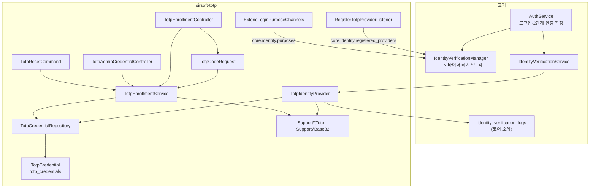

# 인증 앱 2단계 인증 (TOTP) — 아키텍처

> 설계 의도와 계층 구조 · 진입점: [AGENTS.md](../AGENTS.md)

## 설계 의도

<!-- @intent START -->
이 플러그인이 코어에 더하는 것은 **수단 하나**입니다. 로그인 판정·세션 발급·시도 횟수
잠금은 전부 코어 `AuthService` 가 소유하고, 이 플러그인은
`App\Contracts\Extension\IdentityVerificationInterface` 를 구현한 `TotpIdentityProvider`
를 레지스트리에 얹을 뿐입니다. 로그인 코드 확인 엔드포인트를 따로 열지 않는 이유가 여기
있습니다 — 로그인 경로가 두 벌이 되면 잠금·감사 같은 코어 통제가 한쪽에만 걸립니다.

**발송 없는 수단이라는 것이 설계의 축입니다.** 메일 프로바이더는 "코드를 만들어 보낸다"
지만 TOTP 는 코드를 사용자 단말의 앱이 이미 만들고 있습니다. 서버가 하는 일은 challenge
를 열어 두고 제출된 코드를 대조하는 것뿐이며, 이 차이가 세 곳에서 드러납니다.

1. `requestChallenge()` 는 로그를 `IdentityVerificationStatus::Sent` 로 **즉시** 기록합니다.
   코어 `AuthService::startTwoFactorChallenge()` 는 challenge 발행 직후 상태를 조회해
   `Failed` 면 발송 실패로 보고 `TwoFactorDeliveryFailedException` 으로 로그인을 막는데,
   TOTP 에는 확인할 전달 단계가 없습니다. 여기서 `Sent` 는 "보냈다"가 아니라 "사용자가
   코드를 얻을 수 있는 상태가 됐다"는 뜻입니다.
2. challenge 의 `publicPayload` 에 `delivery: 'none'` 과 `code_length: 6` 을 싣습니다.
   프론트가 「인증번호 다시 받기」를 숨기고 부제를 앱 안내로 바꾸는 근거입니다.
3. 본인인증 알림(`category = 'identity'` 알림 정의)을 선언하지 않습니다 — 보낼 메시지가
   없으므로 메일 문구도 두지 않습니다(@deprecated `getIdentityMessages()` 오버라이드도 빈 배열).

**사용자별 등록 여부를 코어가 알아야 합니다.** 코어의 기존 판정 규칙
(`canProviderChallengeUser()` 의 `filled($user->email)`)은 "설정은 켜졌지만 이 사용자는
아직 앱을 등록하지 않았다"를 구분하지 못합니다. 구분하지 못한 채 challenge 를 발행하면
그 계정은 완료할 수 없는 관문 앞에서 영구히 잠깁니다. 그래서 코어가 7.1.0 에서 **opt-in
보조 계약** 두 개를 열었고 이 플러그인이 그 첫 구현자입니다.

| 계약 | 구현 메서드 | 답하는 질문 | 미구현 프로바이더의 코어 기본값 |
|---|---|---|---|
| `UserScopedIdentityProviderInterface` | `canChallengeUser(User)` | 이 사용자에게 지금 challenge 를 발행할 수 있는가 | `filled($user->email)` |
| `MailFallbackAwareProviderInterface` | `allowsMailFallback()` | 이 수단을 쓸 수 없는 사용자를 메일로 되돌려 보내도 되는가 | 허용 |

두 계약을 `IdentityVerificationInterface` 에 직접 넣지 않은 것은 이미 배포된 외부
프로바이더가 전부 깨지기 때문입니다. 폴백 허용 여부를 코어가 아니라 프로바이더가 답하는
것은, 미등록자를 어떻게 다룰지 아는 주체이자 그 설정(`allow_mail_fallback`)을 소유한
주체가 수단을 들여온 확장이기 때문입니다 — 코어에 같은 뜻의 키를 또 두면 두 값이 어긋날
때 어느 쪽이 실효인지 알 수 없게 됩니다.

**고정할 것은 고정합니다.** `Support\Totp` 의 `DIGITS`(6) · `PERIOD`(30) ·
`ALGORITHM`(sha1) 은 상수이고 설정 스키마에 없습니다. 주요 인증 앱이 이 조합만 QR 로
정확히 읽으므로, 열어 두면 운영자가 바꾼 뒤 "앱이 만든 코드가 안 맞는다" 로만 드러나는
고장이 됩니다. `window` 도 `verify()` 호출부에서 1(±30초)로 고정합니다 — 넓히면 탈취된
코드의 유효 시간이 함께 늘어납니다.

**외부 의존성을 들이지 않습니다.** `composer.json` 의 `require` 는 `php: ^8.2` 와
`ext-hash` 뿐입니다. TOTP 계산은 PHP 표준 `hash_hmac` 으로, Base32 는 `Support\Base32`
직접 구현(~40줄)으로 해결합니다 — 이 한 가지 용도에 composer 의존성을 더하면 인증
경로의 공급망 표면만 넓어집니다.

**평문의 수명을 응답 한 번으로 제한합니다.** 시크릿은 `encrypted` cast, 백업 코드는
bcrypt 해시 배열로 저장되고 `TotpCredential::$hidden` 이 둘 다 직렬화에서 제외합니다.
모델을 그대로 돌려주는 경로가 실수로 생겨도 그 자리에서 막힙니다.

**의도적으로 하지 않는 것**: login 이외 purpose 지원(`supportsPurpose()` 가 Login 만
참), 새 purpose·본인인증 알림 선언, 서버측 QR 이미지 생성, 프로바이더 동작을 갈아 끼우는
확장점(인증 통과 조건을 외부에서 바꿀 수 있는 자리는 그 자체가 우회 표면입니다).
<!-- @intent END -->

## 계층 지도

<!-- @intent START -->
이 플러그인에는 두 개의 진입면이 있고, 둘은 서로 다른 계층을 탑니다.

**인증 경로 (코어가 부른다)**: `TotpIdentityProvider` 는 컨트롤러 없이 코어가 직접
호출합니다. `IdentityVerificationLogRepositoryInterface`(코어 저장소)로 challenge 로그를
쓰고, `TotpCredentialRepositoryInterface`(이 플러그인 저장소)로 자격증명을 읽습니다.
challenge 상태는 코어 테이블, 시크릿·백업 코드는 플러그인 테이블 — 평문 계열이 코어
테이블로 넘어가지 않도록 소유가 갈려 있습니다.

**등록 경로 (사용자가 부른다)**: `Controller → TotpCodeRequest → TotpEnrollmentService →
TotpCredentialRepository → TotpCredential` 의 표준 계층입니다. 코드 검증 규칙
(`required|string|min:6|max:32`)은 FormRequest 가 SSoT 이고, 확정·해제·재발급 세
엔드포인트가 같은 입력을 받으므로 한 FormRequest 를 공유합니다. `GET /enrollment` 와
`POST /enrollment` 는 받는 입력이 없어 FormRequest 를 거치지 않습니다.

**계층 규칙**:

- `Service` · `Listener` · `Identity` 는 `TotpCredentialRepositoryInterface` 만 주입받고
  `TotpCredential` 모델이나 `DB` 파사드를 직접 만지지 않습니다. 저장 경로가 한곳에 모여야
  "어디서 시크릿이 쓰이는가" 를 한 파일로 답할 수 있습니다.
- `TotpCredential::matchBackupCode()` 는 남는 목록을 **계산만** 하고 저장하지 않습니다.
  영속은 Repository 몫입니다 — 모델이 스스로 저장하면 그 경로가 감사 대상 밖으로 샙니다.
- `Support\Totp` · `Support\Base32` 는 상태 없는 `final` 클래스입니다. `Totp` 는
  `Base32` 를 쓰지만 그 반대는 없고, 둘 다 Laravel 컨테이너에 바인딩되지 않습니다.
- 바인딩은 `TotpServiceProvider::$repositories` 한 줄
  (`TotpCredentialRepositoryInterface → TotpCredentialRepository`)뿐이고,
  `TotpResetCommand` 와 E2E 픽스처 `PlaywrightSeedTotp`(`playwright:seed-totp`)는
  `runningInConsole()` 일 때만 등록됩니다.
- `playwright:seed-totp` 는 브라우저 실측용입니다 — `--enroll=<email>` 이 확정된 자격증명과
  고정 백업 코드를 심고 시크릿을 출력하며, `--code=<secret>` 이 그 순간의 코드를 계산합니다.
  CLI 한정 + `G7_PLAYWRIGHT_BYPASS=1` 가드 뒤에 있습니다. 종전에는 코어 커맨드가 이 플러그인의
  모델을 직접 import 해 같은 일을 했습니다(코어가 확장을 아는 자리 — 이 플러그인으로 이관).

**세 갈래 해제 경로가 한 서비스로 모입니다**: 본인 해제
(`TotpEnrollmentService::disable()` — 코드 확인 필요), 관리자 강제 해제
(`reset()` — 라우트 권한이 책임), artisan `totp:reset`(같은 `reset()`). 권한 판정은
호출부가 지고 삭제 자체는 한 메서드가 수행하므로, 삭제 규칙이 세 벌로 갈라지지
않습니다.
<!-- @intent END -->

## 디렉토리

<!-- @generated:directory-map START — ext:docgen 이 갱신. 이 블록 안은 직접 수정하지 않는다 -->
| 경로 | 역할 | 수정 시 필요한 절차 |
|---|---|---|
| `plugin.json` | manifest (버전 SSoT) | version 변경 시 package.json·package-lock.json·composer.json 동기화 |
| `plugin.php` | 진입 클래스 (선언형 표면 SSoT) | 표면 변경 시 `ext:docgen` 재실행 + 코어 최소 버전 검토 |
| `src/Http/Controllers/` | 컨트롤러 | API 표면 변경 시 `api:docgen` 재실행 |
| `src/Http/Requests/` | FormRequest (검증 SSoT) | 검증 규칙은 Service 가 아니라 여기에 둔다 |
| `src/Services/` | 비즈니스 로직 | Repository 인터페이스 주입 (구체 클래스 금지) |
| `src/Repositories/` | 데이터 접근 | 목록 쿼리는 컬럼 프루닝·정렬 화이트리스트 확인 |
| `src/Models/` | Eloquent 모델 | 스키마 변경 시 마이그레이션 + 업그레이드 스텝 동반 |
| `src/Listeners/` | 훅 리스너 | Repository 경유 (Model·DB 파사드 직접 접근 금지) |
| `src/routes/` | 라우트 | 모든 라우트에 `name()` 필수 |
| `database/migrations/` | 마이그레이션 | 한국어 comment + `down()` 필수, 기설치본은 업그레이드 스텝으로 백필 |
| `resources/layouts/` | 레이아웃 소스 `.g7.html` (짝 `.json` 은 굽기 산출. 컴포넌트 종류는 `data-type`, 컴파일은 템플릿과 무관) | `php artisan plugin:update sirsoft-totp --force` (빌드 불필요) |
| `resources/js/` | 프론트 엔트리·핸들러 | `php artisan plugin:build` → `php artisan plugin:update sirsoft-totp --force` |
| `resources/extensions/` | 다른 확장 레이아웃에 주입하는 조각 | `php artisan plugin:update sirsoft-totp --force` |
| `editor-spec.json` | 레이아웃 편집기 스펙 | `php artisan plugin:update sirsoft-totp --force` |
| `dist/` | 커밋되는 빌드 산출물 | `--production` 으로 재빌드 (sourceMappingURL 잔존 금지) |
| `config/` | 확장 config | 설정 기본값은 settings 스키마와 어긋나지 않게 |
| `tests/` | 테스트 | 변경 범위만 필터 실행 |
| `CHANGELOG.md` | 변경 이력 | 버전 상향 시 항목 추가 (미기재 시 버전 상향 불가) |
| `components.json` | 편집기 컴포넌트 선언 (레이아웃 작성자가 읽는 props 계약) | `php artisan plugin:update sirsoft-totp --force` |
| `assets/icon.svg` | 확장 아이콘 (관리자 목록·설치 마법사 카드) | 정사각·100KB 이하·스크립트 없는 SVG — 교체 후 `php artisan plugin:update sirsoft-totp --force` |
| `docs/` | 개발자 문서 | 표면 변경 시 `php artisan ext:docgen` 재실행 |
| `lang/` | 다국어 | 키 추가 시 ko·en 동시 반영 + 번들 ja 팩 동기화 |
<!-- @generated:directory-map END -->
